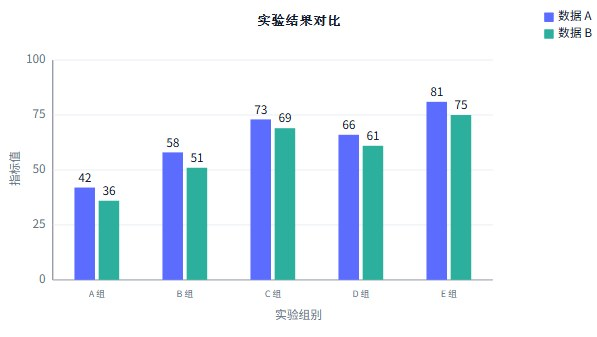
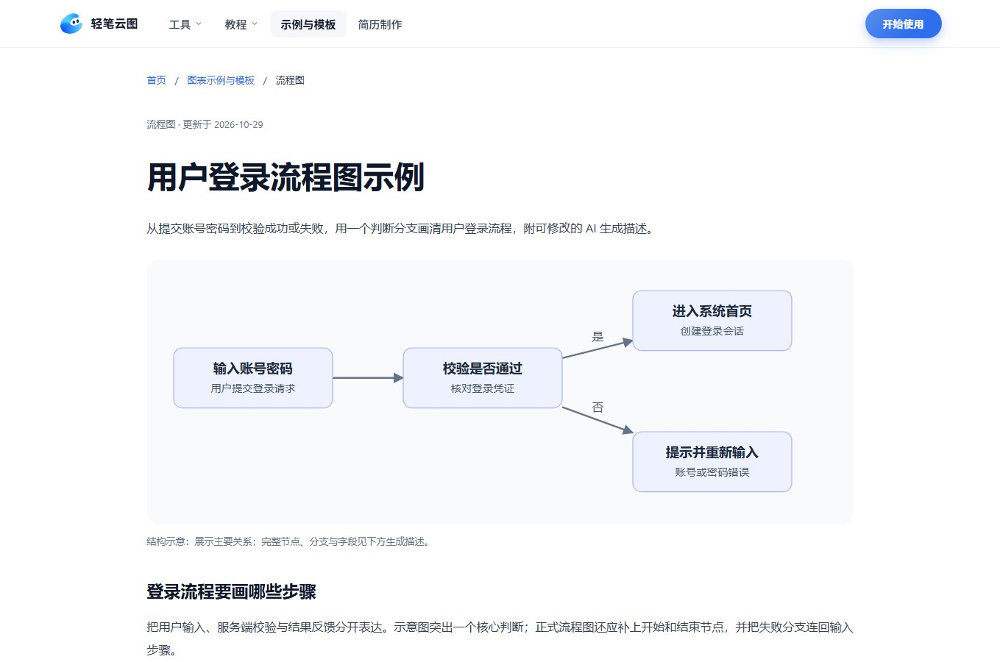
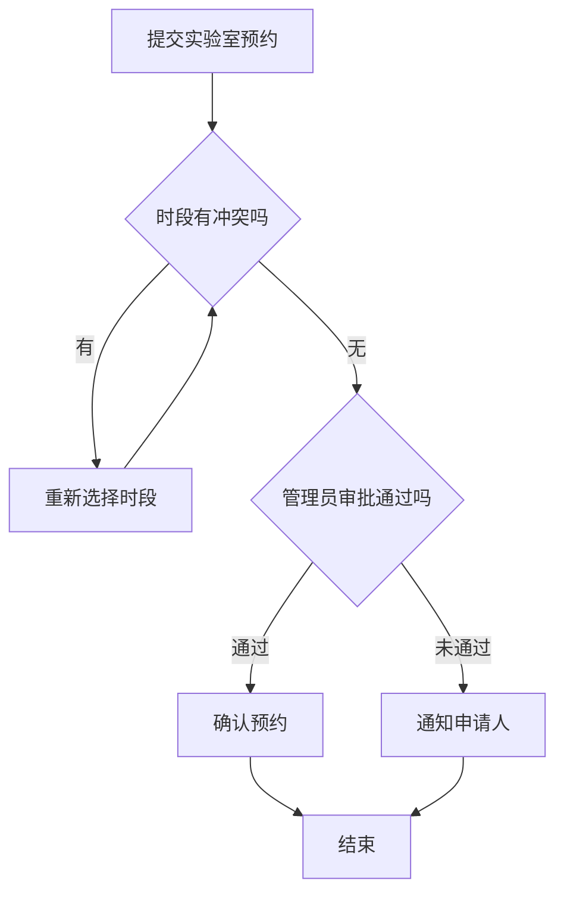
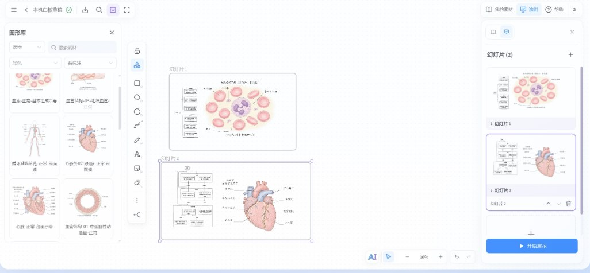
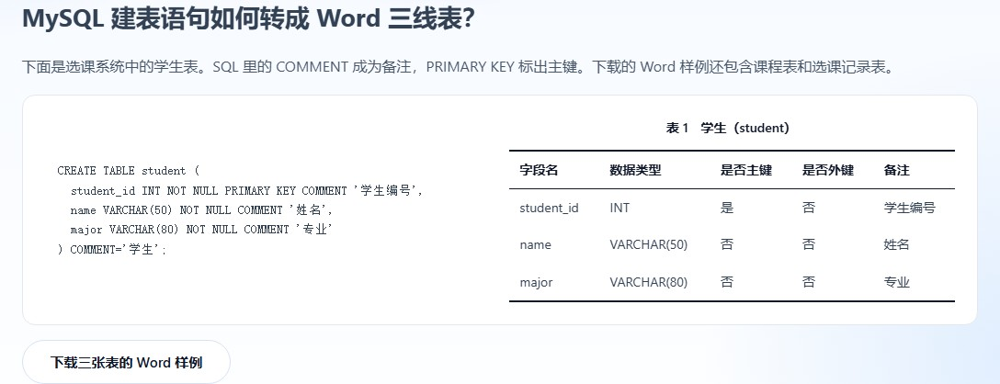
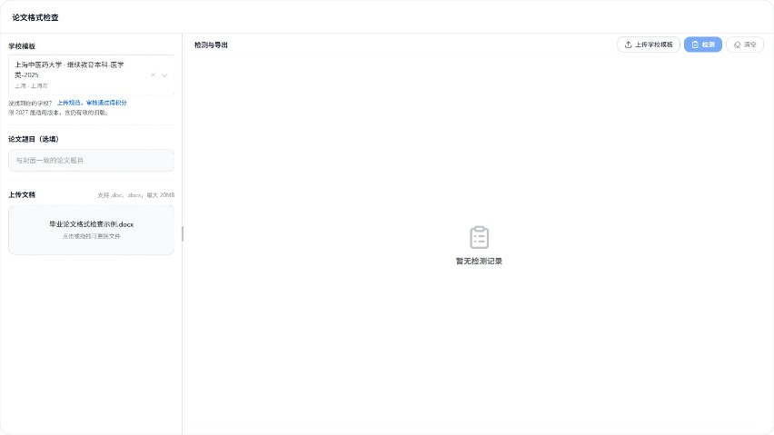
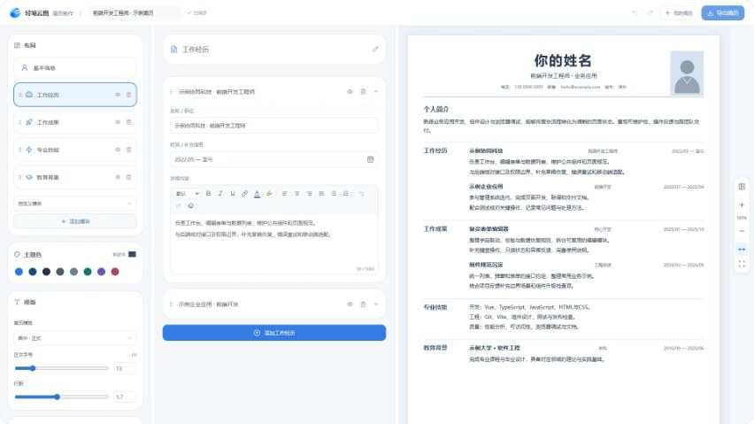

# 图表制作、科研绘图与 Word 论文排版案例

> [!TIP]
> **欢迎免费体验 [hajimicode.cn](https://hajimicode.cn/?utm_source=github&utm_medium=referral&utm_campaign=academic_tools&utm_content=readme_top)**
> 从公开案例入手，按任务打开对应工具试做。


用 Excel 表格画科研统计图，用文字画流程图和思维导图，用建表 SQL 做 ER 图与 Word 三线表。这里按具体任务整理示例，适合毕业论文、实验报告、课程教学、项目计划与工作汇报。可以先复制示例数据，查看预期结果，再打开对应工具试做。

| 我想做什么 | 从这里开始 |
| --- | --- |
| 把 Excel 数据画成分组柱状图，或查找医学、统计和科研图型 | [Excel 数据与科研图表](#excel-数据与科研图表) |
| 把一段文字变成带判断分支的流程图，或拆解课题和项目计划 | [AI 绘图与流程设计](#ai-绘图与流程设计) |
| 做一张时间轴、方案对比信息图，或用在线白板讲课 | [信息图与白板演示](#信息图与白板演示) |
| 用 MySQL 建表语句画 ER 图、做三线表或写测试用例 | [数据库图表与测试文档](#数据库图表与测试文档) |
| 检查 Word 页码、目录、引用和图表编号，准备答辩 PPT | [论文排版与答辩准备](#论文排版与答辩准备) |
| 整理求职简历和项目经历，练习面试追问 | [简历与面试准备](#简历与面试准备) |

## 功能截图与教程目录

| 分类 | 内容 |
| --- | --- |
| [Excel 数据与科研图表](guides/research-charts/README.md) | 5 个功能或案例截图 |
| [AI 绘图与业务流程](guides/ai-drawing/README.md) | 5 个功能或案例截图、3 篇教程 |
| [研究规划与项目汇报](guides/project-planning/README.md) | 6 个功能或案例截图、3 篇教程 |
| [信息图、智绘与白板](guides/infographics-whiteboard/README.md) | 5 个功能或案例截图、3 篇教程 |
| [系统设计与 UML](guides/system-diagrams/README.md) | 12 个功能或案例截图、3 篇教程 |
| [数据库图表与测试文档](guides/database-tables/README.md) | 4 个功能或案例截图、3 篇教程 |
| [论文排版、写作与自查](guides/paper-formatting/README.md) | 6 个功能或案例截图、5 篇教程 |
| [答辩 PPT 与口头汇报](guides/defense/README.md) | 1 个功能或案例截图、3 篇教程 |
| [简历与面试准备](guides/career/README.md) | 1 个功能或案例截图、3 篇教程 |

## Excel 数据与科研图表



### Excel 怎么画带图例的分组柱状图

假设有两种培养条件，在三个时间点分别记录样本测量值。下面是演示数据，可以粘贴到 Excel 或表格编辑器。

```csv
分组,初始,第7天,第14天
条件A,12,18,23
条件B,13,15,17
```

1. 把三个时间点设为横轴类别，用两种颜色表示条件 A 和 B。
2. 纵轴标注测量指标和单位。柱状图用于比较高度时，纵轴通常从 0 起。
3. 成图后检查第 14 天的两根柱分别是 23 和 17，并确认三组柱子使用同一比例尺。如果每个条件还有多次观测，先明确是要展示均值、分布，还是每条原始记录。

[查看柱状图数据格式与绘制步骤](https://hajimicode.cn/tools/academic-charts/bar?utm_source=github&utm_medium=referral&utm_campaign=academic_tools&utm_content=tools_academic-charts_bar)

### 论文统计图该选哪一种

| 要回答的问题 | 可以先看的图型 | 准备什么数据 |
| --- | --- | --- |
| 几组指标差多少，指标随时间怎么变 | 柱状图、折线图 | 分组标签、数值和单位，或按时间排序的记录 |
| 两个连续变量有没有关联，各组数据是什么分布 | 散点图、箱线图、直方图 | 成对观测值，或按组保留的原始数值 |
| 一组特征在不同样本中的模式是什么 | 热图、聚类热图 | 样本与特征的数值矩阵、行列标签 |
| 怎么展示分类器在不同阈值下的表现 | ROC 曲线、PR 曲线 | 预测分数和实际二元标签，或已经计算好的曲线坐标 |
| 怎么画带删失记录的生存曲线 | [Kaplan–Meier 生存曲线](https://hajimicode.cn/tools/academic-charts/kaplan-meier-raw?utm_source=github&utm_medium=referral&utm_campaign=academic_tools&utm_content=tools_academic-charts_kaplan-meier-raw) | 随访时长、事件或删失状态、分组 |
| 怎么画同时展示变化幅度与显著性的图 | [火山图](https://hajimicode.cn/tools/academic-charts/volcano?utm_source=github&utm_medium=referral&utm_campaign=academic_tools&utm_content=tools_academic-charts_volcano) | 标识、log2FC 与 P 值或 FDR，明确显著性口径 |
| 文献检索、去重、筛选各剩多少篇 | [PRISMA 文献筛选流程图](https://hajimicode.cn/tools/academic-charts/prisma-flow?utm_source=github&utm_medium=referral&utm_campaign=academic_tools&utm_content=tools_academic-charts_prisma-flow) | 各阶段数量及主要排除理由 |

科研图表目录还包括森林图、相关性矩阵、桑基图和多种学科图型。用于论文时，在图注里补齐单位、样本量、分组含义和统计口径。[查看学术图表目录](https://hajimicode.cn/tools/academic-charts?utm_source=github&utm_medium=referral&utm_campaign=academic_tools&utm_content=tools_academic-charts)

## AI 绘图与流程设计



### 一段文字怎么变成带是非分支的流程图

实验室预约需要处理时段冲突和管理员审批。以下是虚构的输入示例。

> 提交预约后，检查预约时段是否与已有记录冲突。有冲突时请选择其他时段，并再次检查。无冲突时由管理员审批。通过则确认预约，未通过则通知申请人并结束。

生成初稿后，检查冲突分支是否返回到选时段、审批的通过和未通过是否各有出口，以及各节点是否有明确的下一步。想展示申请人、系统和管理员各自负责什么，可以把同一流程画成三条泳道。



[用文字生成图表初稿](https://hajimicode.cn/dashboard?utm_source=github&utm_medium=referral&utm_campaign=academic_tools&utm_content=dashboard) · [查看 AI 流程图教程](https://hajimicode.cn/tutorials/ai-flowchart?utm_source=github&utm_medium=referral&utm_campaign=academic_tools&utm_content=tutorials_ai-flowchart) · [查看泳道图画法](https://hajimicode.cn/tutorials/swimlane-diagram?utm_source=github&utm_medium=referral&utm_campaign=academic_tools&utm_content=tutorials_swimlane-diagram)

### 开题报告技术路线图和项目甘特图怎么做

以校园节水调研为例，技术路线图可以按「明确问题 → 采集记录 → 清洗与分析 → 验证结果 → 提出改进方案」展开，每一步写清产物。甘特图则给采集、分析、复核和汇报安排日期，注明哪些任务必须等上一阶段结束。用于论文提纲或课程复习时，可以把章节与子主题整理成思维导图。

| 表达需求 | 适合的图 |
| --- | --- |
| 展示研究方法、任务阶段和阶段交付 | [技术路线图](https://hajimicode.cn/tutorials/research-roadmap?utm_source=github&utm_medium=referral&utm_campaign=academic_tools&utm_content=tutorials_research-roadmap) |
| 安排开始日期、工期、依赖和验收里程碑 | [项目甘特图](https://hajimicode.cn/tutorials/gantt-project-plan?utm_source=github&utm_medium=referral&utm_campaign=academic_tools&utm_content=tutorials_gantt-project-plan) |
| 整理章节结构、课程知识或会议议题 | [思维导图](https://hajimicode.cn/tools/mindmap?utm_source=github&utm_medium=referral&utm_campaign=academic_tools&utm_content=tools_mindmap) |
| 复盘问题，从人员、设备、方法等维度梳理成因 | [鱼骨图](https://hajimicode.cn/tools/fishbone?utm_source=github&utm_medium=referral&utm_campaign=academic_tools&utm_content=tools_fishbone) |
| 把关键事件和阶段成果沿时间顺序排列 | [项目时间轴](https://hajimicode.cn/tools/timeline?utm_source=github&utm_medium=referral&utm_campaign=academic_tools&utm_content=tools_timeline) |

## 信息图与白板演示



### 一张图展示方案对比、项目进度或组织关系

写项目简报时，可以选时间轴呈现进度、用对比图说明备选方案、用层级图介绍团队职责、用 SWOT 四象限整理讨论。比如社区活动方案对比，可以用两栏分别放室内和室外方案，每栏按预算、人数和天气影响写对应要点。[浏览信息图模板](https://hajimicode.cn/tools/infographic/templates?utm_source=github&utm_medium=referral&utm_campaign=academic_tools&utm_content=tools_infographic_templates)

### 在线白板怎么用于教学和项目汇报

备课可以把白板分成「概念讲解」「例题演算」「课堂小结」三个区域，在每一区放入文字、图形库素材和示意连线，再按讲课顺序做成演示。项目评审也可以依次摆放背景、方案、风险和下一步。需要单独细调流程图、架构图和 UML 的图形、连线或样式时，可以使用专业绘图入口。[了解智绘白板](https://hajimicode.cn/tools/board?utm_source=github&utm_medium=referral&utm_campaign=academic_tools&utm_content=tools_board) · [查看白板演示教程](https://hajimicode.cn/tutorials/whiteboard-presentation?utm_source=github&utm_medium=referral&utm_campaign=academic_tools&utm_content=tutorials_whiteboard-presentation) · [了解智绘云图](https://hajimicode.cn/tools/zhihui?utm_source=github&utm_medium=referral&utm_campaign=academic_tools&utm_content=tools_zhihui)

## 数据库图表与测试文档



### MySQL 建表 SQL 怎么生成 ER 图和 Word 三线表

用一个虚构的学生选课例子试做。学生和课程各有一张表，选课记录表连接两边。示例可直接复制到工具里作为输入。

```sql
CREATE TABLE student (
  id INT PRIMARY KEY COMMENT '学生编号',
  name VARCHAR(50) NOT NULL COMMENT '姓名'
);

CREATE TABLE course (
  id INT PRIMARY KEY COMMENT '课程编号',
  course_name VARCHAR(80) NOT NULL COMMENT '课程名称'
);

CREATE TABLE enrollment (
  student_id INT NOT NULL COMMENT '学生编号',
  course_id INT NOT NULL COMMENT '课程编号',
  enrolled_on DATE NOT NULL COMMENT '选课日期',
  PRIMARY KEY (student_id, course_id),
  FOREIGN KEY (student_id) REFERENCES student(id),
  FOREIGN KEY (course_id) REFERENCES course(id)
);
```

- **ER 图**可核对三张实体表以及两条一对多关系。学生和课程通过选课记录形成多对多关系。
- **Word 三线表**可查看字段名、数据类型和字段说明，再按学校或项目模板调整标题、字体和线宽。
- **SQL 没有外键**时，先确认字段之间的实际业务含义，再手动补上关系和基数。

[从 SQL 生成 ER 图](https://hajimicode.cn/tools/er-diagram?utm_source=github&utm_medium=referral&utm_campaign=academic_tools&utm_content=tools_er-diagram) · [从 SQL 生成 Word 三线表](https://hajimicode.cn/tools/table?utm_source=github&utm_medium=referral&utm_campaign=academic_tools&utm_content=tools_table) · [查看无外键 SQL 的补关系教程](https://hajimicode.cn/tutorials/sql-to-er-diagram?utm_source=github&utm_medium=referral&utm_campaign=academic_tools&utm_content=tutorials_sql-to-er-diagram)

### 系统设计和验收交付怎么选图

系统模块图用来梳理业务功能，系统架构图适合说明展示层、业务层和数据层如何连接。接口请求可用时序图，带条件的业务步骤可用流程图。需求评审中可以画用例图，说明角色与系统能力的关系，也可以用类图梳理类、属性、关联和继承。工具目录里还有数据流图、协作图、状态图、网络拓扑图、部署图和对象图的入口。[查看绘图工具目录](https://hajimicode.cn/tools?utm_source=github&utm_medium=referral&utm_campaign=academic_tools&utm_content=tools) · [系统架构图](https://hajimicode.cn/tools/architecture?utm_source=github&utm_medium=referral&utm_campaign=academic_tools&utm_content=tools_architecture) · [UML 类图与对象图](https://hajimicode.cn/tools/uml-designer?utm_source=github&utm_medium=referral&utm_campaign=academic_tools&utm_content=tools_uml-designer)

验收文档可以从测试用例表开始。比如测试登录时，分别记录正确密码、错误密码和账号锁定三个用例，为每条写上前置条件、输入、操作步骤和预期结果。[查看登录功能测试用例与 Word 模板](https://hajimicode.cn/tools/test-case?utm_source=github&utm_medium=referral&utm_campaign=academic_tools&utm_content=tools_test-case)

## 论文排版与答辩准备



### Word 论文格式检查从哪里开始

| 检查什么 | 怎么确认 |
| --- | --- |
| 页面与正文 | 对照适用的学校模板检查纸张、页边距、字体、字号、缩进和行距 |
| 标题和目录 | 确认标题层级与正文结构吻合，更新自动目录，核对标题文字和页码 |
| 页眉、页脚与页码 | 按模板检查分节位置、起始页码和编号格式 |
| 插图、三线表与公式 | 核对编号、图表题注位置、正文引用与公式显示 |
| 引文和参考文献 | 逐条比对正文引用与文末条目，按材料类型补齐著录信息 |

[查看论文格式检查工具](https://hajimicode.cn/tools/format-check?utm_source=github&utm_medium=referral&utm_campaign=academic_tools&utm_content=tools_format-check) · [了解检查报告与 Word 批注](https://hajimicode.cn/tutorials/format-check?utm_source=github&utm_medium=referral&utm_campaign=academic_tools&utm_content=tutorials_format-check) · [查看自动目录与分节页码教程](https://hajimicode.cn/tutorials/toc-page-numbers?utm_source=github&utm_medium=referral&utm_campaign=academic_tools&utm_content=tutorials_toc-page-numbers)

### 参考文献、LaTeX 公式和文本修改怎么处理

- 做 **参考文献排版** 时，先整理已有的作者、题名、来源和出版信息，再按学校要求选择相应格式。期刊、书籍、网页的著录字段不同。[查看 GB/T 7714 排版示例](https://hajimicode.cn/tutorials/references?utm_source=github&utm_medium=referral&utm_campaign=academic_tools&utm_content=tutorials_references)
- 测试 **LaTeX 转 Word 公式** 时，可以先输入一个简单的分式 `\frac{a+b}{c}`，导出后打开 Word，确认符号、上下标和可编辑性。[查看 LaTeX 转可编辑 Word 公式](https://hajimicode.cn/tools/formula?utm_source=github&utm_medium=referral&utm_campaign=academic_tools&utm_content=tools_formula)
- 整理 **论文提纲** 时，先拆解研究问题、相关工作、方法、结果和讨论，再为每节标出要引用的证据。论文写作工具介绍可查看当前能力；润色页面也提供表达修改指南。[查看论文写作工具介绍](https://hajimicode.cn/tools/paper-writing?utm_source=github&utm_medium=referral&utm_campaign=academic_tools&utm_content=tools_paper-writing) · [查看论文表达修改指南](https://hajimicode.cn/tools/paper-polish?utm_source=github&utm_medium=referral&utm_campaign=academic_tools&utm_content=tools_paper-polish)
- 阅读 **AIGC 检测报告** 时，可以查看分段结果并回到上下文复核，结合稿件来源、引用和修改记录判断。分数可作为自查参考。[查看分段检测结果解读](https://hajimicode.cn/tutorials/aigc-check?utm_source=github&utm_medium=referral&utm_campaign=academic_tools&utm_content=tutorials_aigc-check)

### 答辩 PPT 和五分钟答辩稿怎么准备

先列出研究问题、所用方法、主要结果、结论和局限。每张结果页配一张最能说明观点的图或表，口头讲述时用一句话解释它回答了什么问题。答辩前可按「为什么这样做」「用什么证据验证」「有哪些限制」各准备一个回答。[查看答辩 PPT 工具](https://hajimicode.cn/tools/defense-ppt?utm_source=github&utm_medium=referral&utm_campaign=academic_tools&utm_content=tools_defense-ppt) · [查看五分钟答辩稿结构](https://hajimicode.cn/tutorials/defense-script?utm_source=github&utm_medium=referral&utm_campaign=academic_tools&utm_content=tutorials_defense-script) · [查看常见答辩追问](https://hajimicode.cn/tutorials/defense-questions?utm_source=github&utm_medium=referral&utm_campaign=academic_tools&utm_content=tutorials_defense-questions)

## 简历与面试准备



应届生简历可以先整理课程、项目、实验或实习经历，再选与职位相关的两到三个例子。每条项目经历尽量写清自己负责什么、用什么方法、有哪些可以说明的结果。导出 A4 PDF 后检查分页和阅读顺序。面试练习时，把脱敏后的简历和岗位描述放在一起，准备技术选择、方案取舍和项目复盘等追问。[查看简历制作工具](https://hajimicode.cn/tools/resume?utm_source=github&utm_medium=referral&utm_campaign=academic_tools&utm_content=tools_resume) · [查看岗位面试练习教程](https://hajimicode.cn/tutorials/ai-interview-preparation?utm_source=github&utm_medium=referral&utm_campaign=academic_tools&utm_content=tutorials_ai-interview-preparation)

## 相关资源

**欢迎免费体验 [hajimicode.cn](https://hajimicode.cn/?utm_source=github&utm_medium=referral&utm_campaign=academic_tools&utm_content=readme_footer)**

[轻笔云图](https://hajimicode.cn/?utm_source=github&utm_medium=referral&utm_campaign=academic_tools&utm_content=home) · [图表与文档工具目录](https://hajimicode.cn/tools?utm_source=github&utm_medium=referral&utm_campaign=academic_tools&utm_content=tools) · [示例与模板](https://hajimicode.cn/templates?utm_source=github&utm_medium=referral&utm_campaign=academic_tools&utm_content=templates) · [教程中心](https://hajimicode.cn/tutorials?utm_source=github&utm_medium=referral&utm_campaign=academic_tools&utm_content=tutorials)
