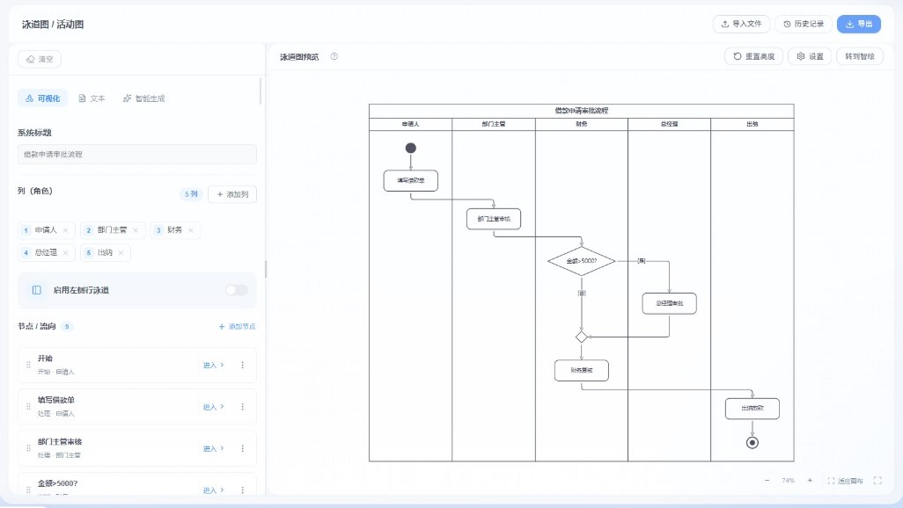
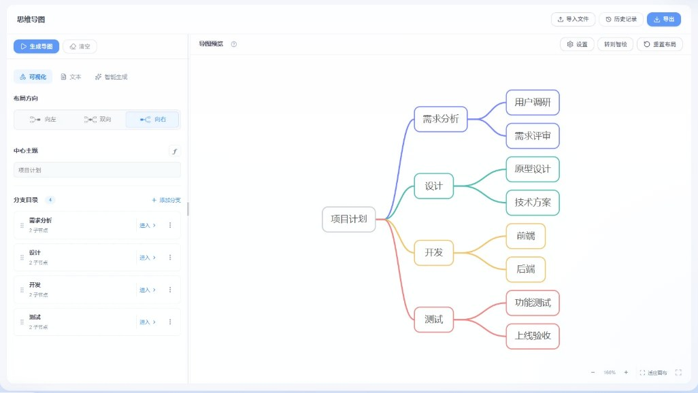
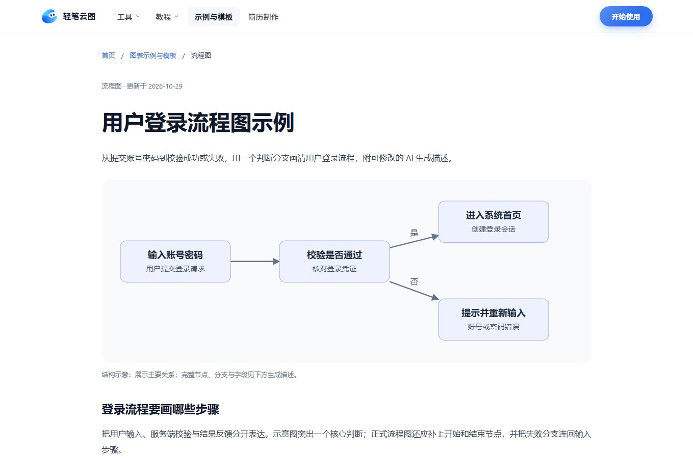

# AI 绘图与业务流程

[返回案例总览](../../README.md)

## 功能与截图

### AI 图表工作台

按自然语言描述生成图表初稿，复核节点、关系和分支后继续编辑。

[查看主站介绍](https://hajimicode.cn/dashboard?utm_source=github&utm_medium=referral&utm_campaign=academic_tools&utm_content=module_ai-dashboard)

### 系统流程图

从输入到输出画清步骤，给每个判断出口标上实际条件。

[查看主站介绍](https://hajimicode.cn/tools/systemflow?utm_source=github&utm_medium=referral&utm_campaign=academic_tools&utm_content=module_systemflow)

### 泳道图与活动图

按人员或系统分道，在同一张图里展示交接与退回。

[查看主站介绍](https://hajimicode.cn/tools/swimlane?utm_source=github&utm_medium=referral&utm_campaign=academic_tools&utm_content=module_swimlane)

### 思维导图

把课程知识、论文提纲或会议议题整理成可展开的层级。

[查看主站介绍](https://hajimicode.cn/tools/mindmap?utm_source=github&utm_medium=referral&utm_campaign=academic_tools&utm_content=module_mindmap)

### 用户登录流程图案例

沿用户输入、验证、成功和重试查看登录流程的判断分支。

[查看主站介绍](https://hajimicode.cn/templates/user-login-flowchart?utm_source=github&utm_medium=referral&utm_campaign=academic_tools&utm_content=module_systemflow-example)

## 教程

- [系统流程图怎么画，从起点写到异常出口](flowchart.md)
- [AI 流程图怎么写描述，才能画出判断和回退](ai-flowchart.md)
- [泳道图怎么画，把跨角色审批分到各自泳道](swimlane-diagram.md)
