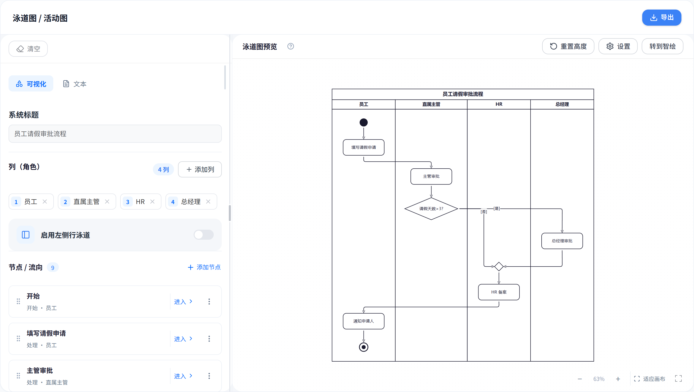

# 泳道图怎么画，把跨角色审批分到各自泳道

[返回AI 绘图与业务流程](README.md) · [查看总目录](../../README.md)

需要解释人员或系统的交接时，可以给每个角色一条泳道。读者扫一眼就能找到谁负责提交、判断或通知。

截图展示对应工具的示例操作。

## 操作步骤

1. 先把申请人、审核人和系统分成三个角色。每个角色只放自己负责的动作。
2. 沿时间顺序摆放节点，跨角色交接时把连线画进下一条泳道，条件箭头注明结果。
3. 补齐退回路径并处理交叉。多人评审时，逐个角色核对接收内容和交付结果。

## 示例

以请假审批为例，申请人提交，主管批准或驳回，系统记录结论并通知申请人。若需要补材料，回到申请人的补交动作。

## 完成后检查

用不同方向查看横版或竖版，确认泳道标题和跨栏交接都清楚。

[在线制作泳道图](https://hajimicode.cn/tools/swimlane?utm_source=github&utm_medium=referral&utm_campaign=academic_tools&utm_content=guide_swimlane-diagram_try) · [查看主站原教程](https://hajimicode.cn/tutorials/swimlane-diagram?utm_source=github&utm_medium=referral&utm_campaign=academic_tools&utm_content=guide_swimlane-diagram_source)
