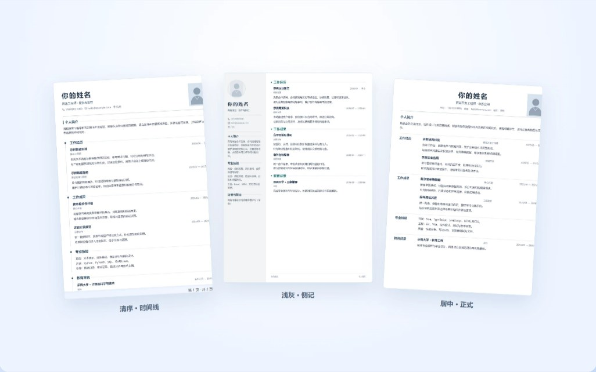

# 简历与面试准备

[返回案例总览](../../README.md)

## 功能与截图

### 在线简历制作

在 A4 版面组织项目、科研、实习和教育经历，预览后导出。

[查看主站介绍](https://hajimicode.cn/tools/resume?utm_source=github&utm_medium=referral&utm_campaign=academic_tools&utm_content=module_resume)

## 教程

- [在线简历怎么写，把项目经历写成可以追问的事实](resume-writing.md)
- [简历 A4 排版与 PDF 导出怎么检查分页](resume-layout-export.md)
- [怎么按简历和岗位 JD 准备面试题与可能追问](ai-interview-preparation.md)
