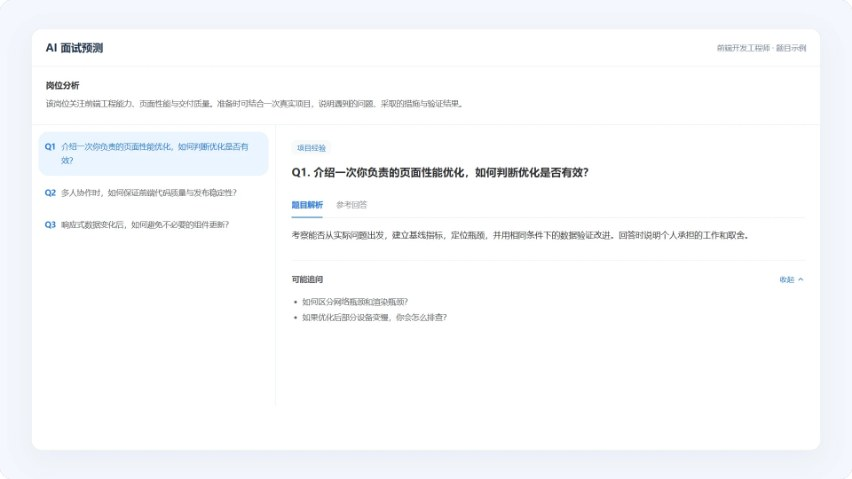

# 怎么按简历和岗位 JD 准备面试题与可能追问

[返回简历与面试准备](README.md) · [查看总目录](../../README.md)

想练习某个岗位，可以把真实项目经历与明确的岗位要求放在一起，生成候选问题，再以自己的证据组织回答。

截图来自主站原教程。

## 操作步骤

1. 整理脱敏简历与岗位 JD，写清目标角色、技能要求和你想练的经历。去掉联系人、私人地址与组织内部资料。
2. 先阅读岗位分析，挑出最相关的问题。把参考回答改写成自己的背景、行动、取舍和结果。
3. 追加两个层次的追问，一个问技术或方法细节，一个问复盘与改进。复习时从真实项目中找证据。

## 示例

数据分析岗位可以准备「为什么选这一图型」「缺失值怎么处理」「如何让结果能被复核」等追问。

## 完成后检查

每个答案能说清个人贡献，并能说明结果通过什么方式确认。

[查看简历与面试工具](https://hajimicode.cn/tools/resume?utm_source=github&utm_medium=referral&utm_campaign=academic_tools&utm_content=guide_ai-interview-preparation_try) · [查看主站原教程](https://hajimicode.cn/tutorials/ai-interview-preparation?utm_source=github&utm_medium=referral&utm_campaign=academic_tools&utm_content=guide_ai-interview-preparation_source)
