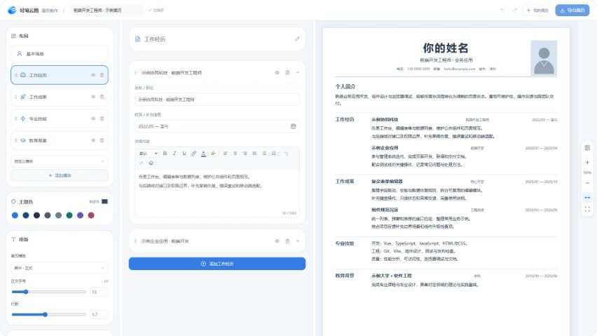

# 简历 A4 排版与 PDF 导出怎么检查分页

[返回简历与面试准备](README.md) · [查看总目录](../../README.md)

交付给用人方的 PDF 宜用统一的字体、间距和层级。修改经历后，重新检查 A4 预览和导出文件。

截图来自主站原教程。

## 操作步骤

1. 先定模块顺序，把经历和教育等关键信息放在容易找到的位置。用一致的字号、对齐和段落间距表现层级。
2. 检查分页，避免标题落在页底而内容被挤到下一页。空间不足时先缩短冗余句，再调整间距。
3. 导出 PDF 后在独立阅读器打开，核对是否出现缺字、裁切、空白页和过浅的文字。保存可编辑稿供后续更新。

## 示例

当一段实习跨页时，优先删掉含义重复的短句，让职位、时间和至少一个主要成果出现在同一页。

## 完成后检查

打印预览的页边距合理，文件名和个人联系信息正确。

[查看简历制作与 PDF 导出](https://hajimicode.cn/tools/resume?utm_source=github&utm_medium=referral&utm_campaign=academic_tools&utm_content=guide_resume-layout-export_try) · [查看主站原教程](https://hajimicode.cn/tutorials/resume-layout-export?utm_source=github&utm_medium=referral&utm_campaign=academic_tools&utm_content=guide_resume-layout-export_source)
