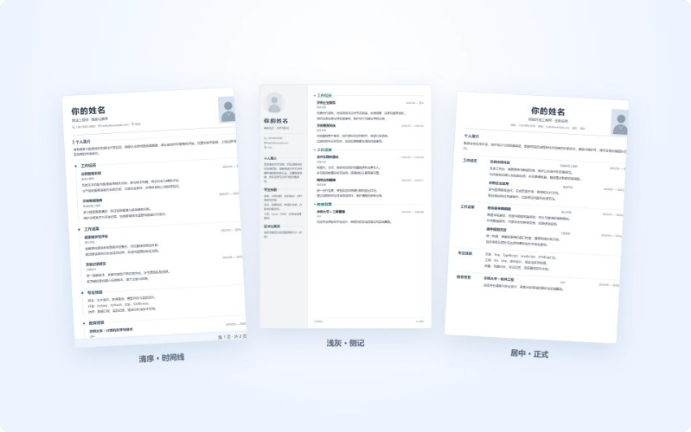

# 在线简历怎么写，把项目经历写成可以追问的事实

[返回简历与面试准备](README.md) · [查看总目录](../../README.md)

简历内容可以从目标岗位要求出发，把课程、实习、科研或志愿经历整理成有背景、有分工、有结果的条目。

截图来自主站原教程。

## 操作步骤

1. 选与你的求职阶段匹配的版式，先填写准确的教育、经历和联系信息。将与岗位最相关的内容放在阅读时最早能看到的位置。
2. 每条项目经历说明你负责什么、做了什么、怎样验证结果。数字来自实际材料，个人贡献与团队产出区分清楚。
3. 针对不同岗位切换重点，逐项核对日期、术语和联系方式，再检查 A4 的实际预览。

## 示例

科研项目可写明自己负责的样本记录、数据整理或图表制作，并给出能说明工作量的实际范围。

## 完成后检查

每条经历都能举出具体例子，关键词与岗位描述相符。

[在线编辑简历](https://hajimicode.cn/tools/resume?utm_source=github&utm_medium=referral&utm_campaign=academic_tools&utm_content=guide_resume-writing_try) · [查看主站原教程](https://hajimicode.cn/tutorials/resume-writing?utm_source=github&utm_medium=referral&utm_campaign=academic_tools&utm_content=guide_resume-writing_source)
