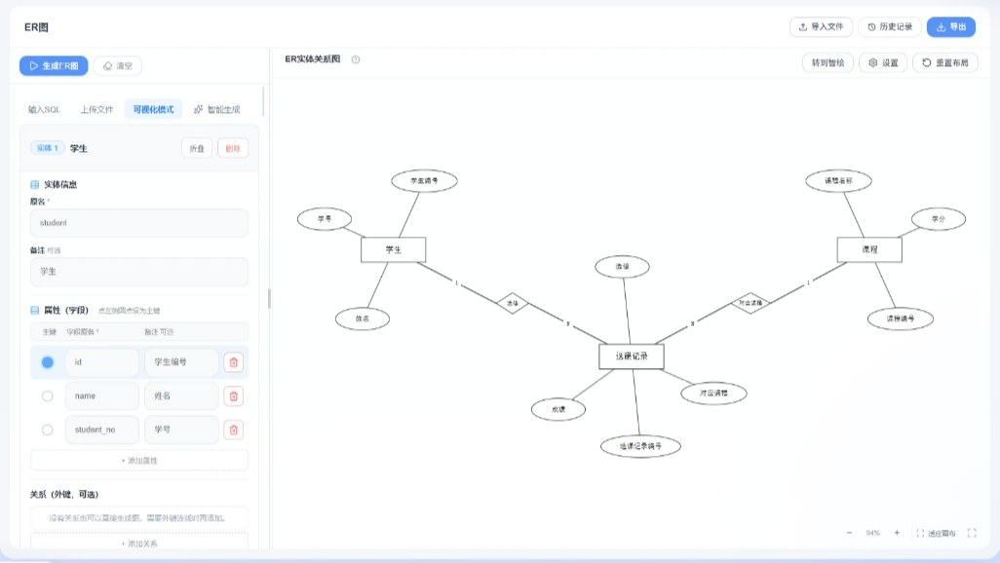
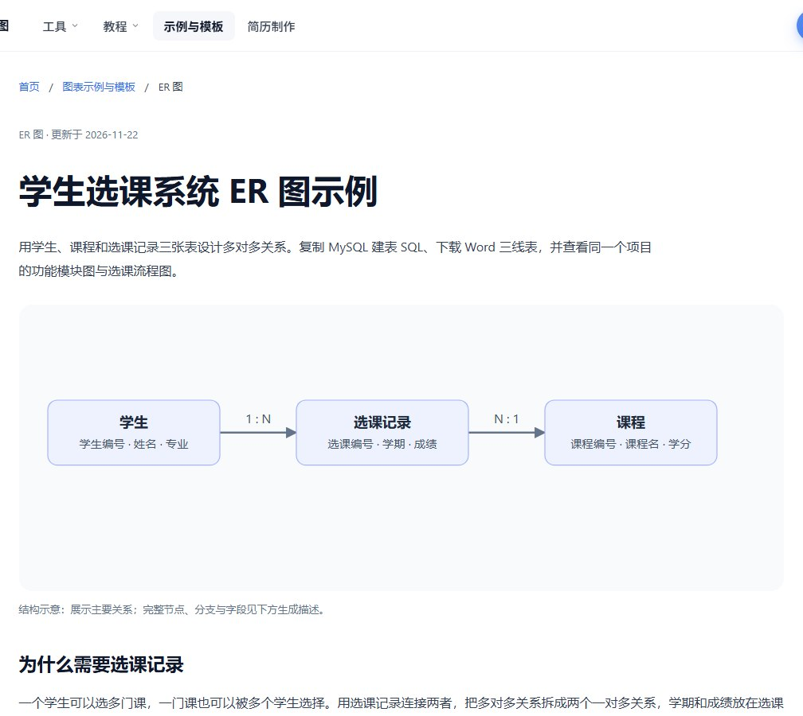
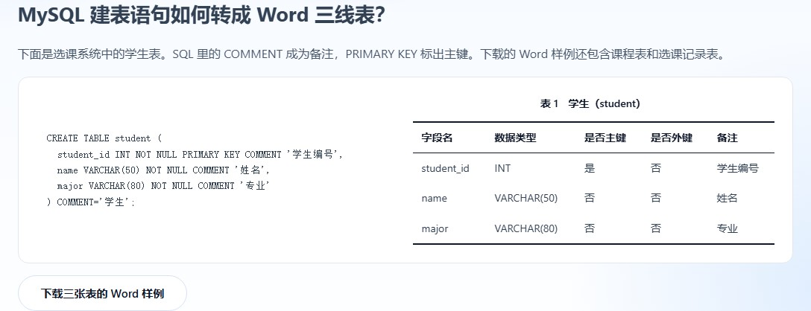
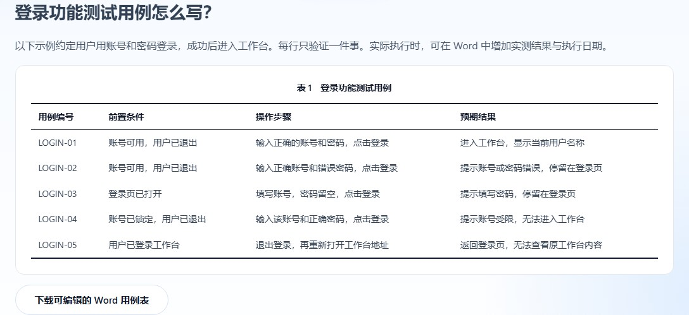

# 数据库图表与测试文档

[返回案例总览](../../README.md)

## 功能与截图

### ER 实体关系图

用实体、属性、主外键和基数说明数据库对象之间的关系。

[查看主站介绍](https://hajimicode.cn/tools/er-diagram?utm_source=github&utm_medium=referral&utm_campaign=academic_tools&utm_content=module_er)

### 学生选课 ER 图案例

通过学生、课程与选课记录解释多对多关系。

[查看主站介绍](https://hajimicode.cn/templates/student-course-er?utm_source=github&utm_medium=referral&utm_campaign=academic_tools&utm_content=module_student-course)

### SQL 转 Word 三线表

将建表 SQL 的字段、类型、主键与注释整理成可编辑的 Word 表格。

[查看主站介绍](https://hajimicode.cn/tools/table?utm_source=github&utm_medium=referral&utm_campaign=academic_tools&utm_content=module_three-line-table)

### 测试用例表

列出前置条件、操作步骤与预期结果，记录正常和异常测试。

[查看主站介绍](https://hajimicode.cn/tools/test-case?utm_source=github&utm_medium=referral&utm_campaign=academic_tools&utm_content=module_test-case)

## 教程

- [Word 论文三线表怎么做，SQL 字段注释怎么保留](three-line-table.md)
- [毕业论文 ER 图怎么画，从实体到基数](er-diagram.md)
- [MySQL 没写外键，如何补全 ER 图的表关系](sql-to-er-diagram.md)
