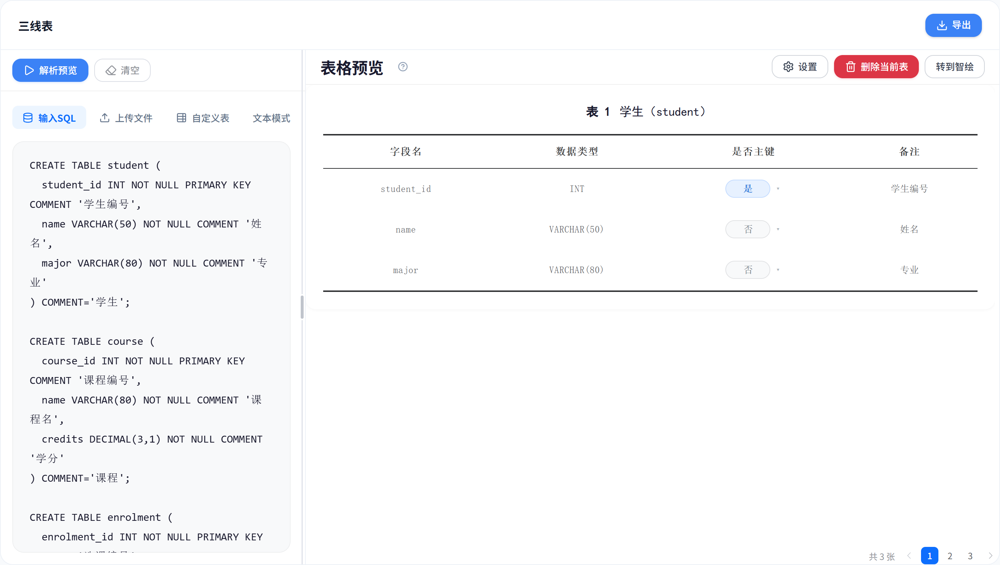

# Word 论文三线表怎么做，SQL 字段注释怎么保留

[返回数据库图表与测试文档](README.md) · [查看总目录](../../README.md)

论文中的三线表能清楚地区分表头和数据。常见结构是表格顶线、表头下边线和底线，同一份规范也可用于项目数据字典。

截图展示对应工具的示例操作。

## 操作步骤

1. 在 Word 插入表格，选中整表并清除默认边框，再分别给首行加上、下边线，给最后一行加底线。各条线的粗细按学校模板设置。
2. 已有数据库结构时，复制 MySQL 的 CREATE TABLE 语句，检查每个字段的 COMMENT。导入后核对字段名、类型、主键和备注。
3. 导出 Word 后插入正文，补表号与表题。长表跨页时设置重复表头，再用打印预览检查。

## 示例

以选课记录表为例，表头写「字段名、数据类型、说明」，表内用 student_id、course_id 和 enrolled_on。日期列说明填写「选课日期」。

## 完成后检查

标题编号与正文引用一致，整表无多余竖线。

[在线生成 Word 三线表](https://hajimicode.cn/tools/table?utm_source=github&utm_medium=referral&utm_campaign=academic_tools&utm_content=guide_three-line-table_try) · [查看主站原教程](https://hajimicode.cn/tutorials/three-line-table?utm_source=github&utm_medium=referral&utm_campaign=academic_tools&utm_content=guide_three-line-table_source)
