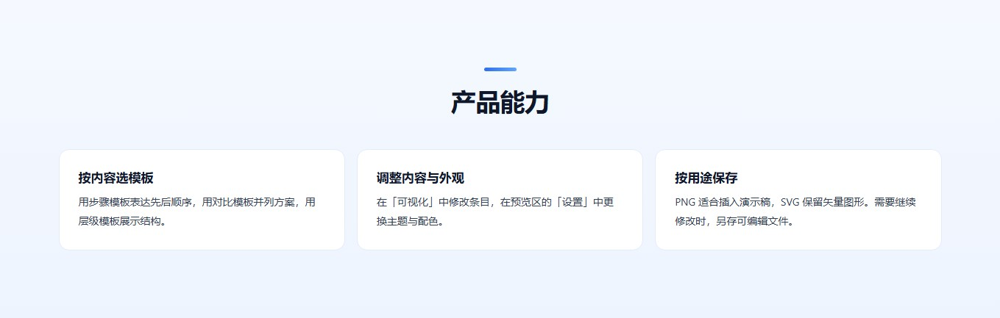
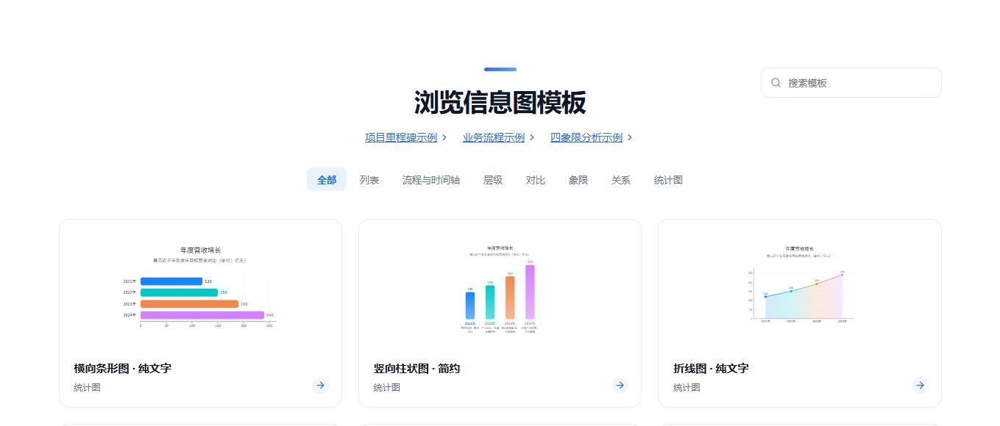
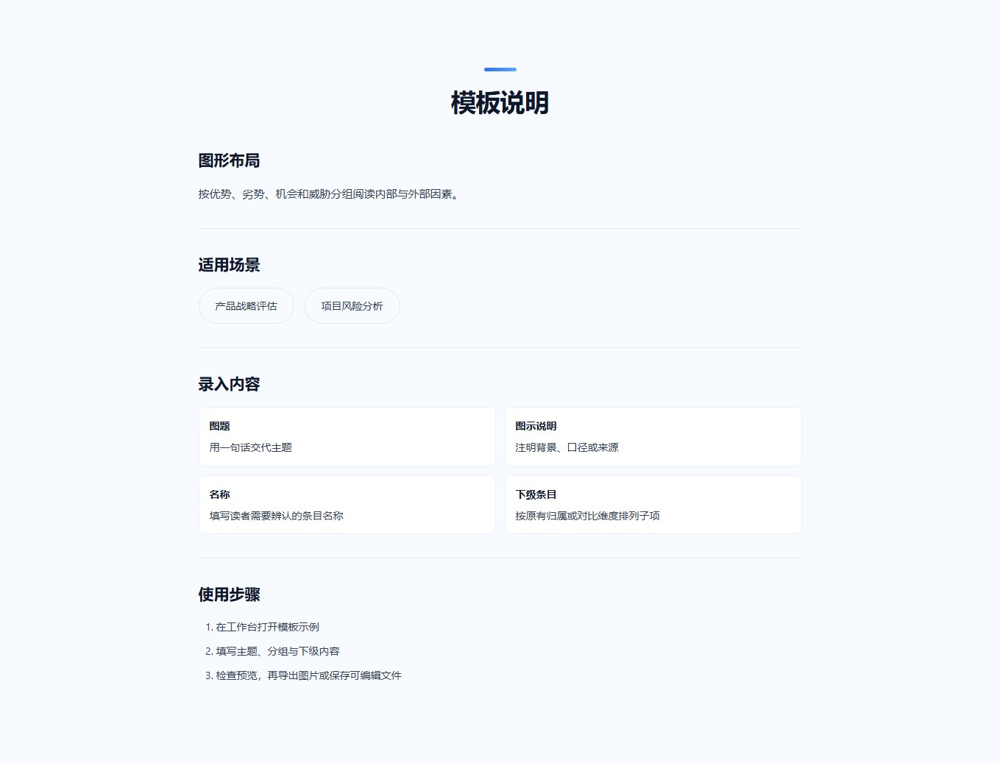
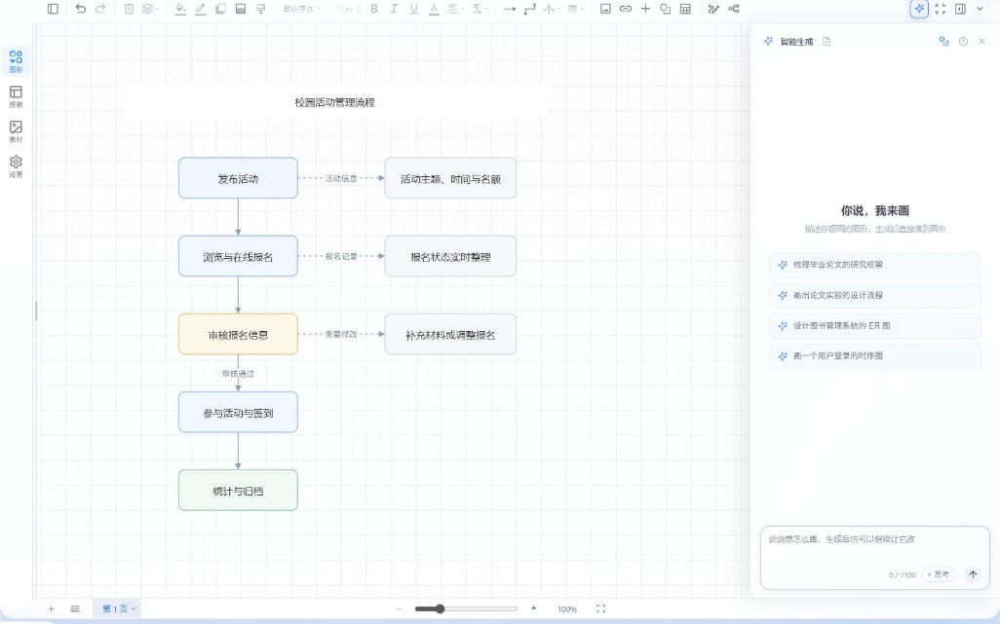
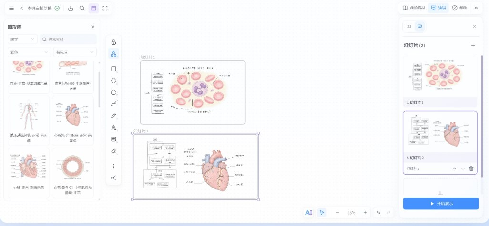

# 信息图、智绘与白板

[返回案例总览](../../README.md)

## 功能与截图

### 信息图在线制作

使用列表、层级、对比、步骤和数据图形来做资料摘要。

[查看主站介绍](https://hajimicode.cn/tools/infographic?utm_source=github&utm_medium=referral&utm_campaign=academic_tools&utm_content=module_infographic)

### 信息图模板目录

按要表达的内容挑模板，核对模板的输入字段。

[查看主站介绍](https://hajimicode.cn/tools/infographic/templates?utm_source=github&utm_medium=referral&utm_campaign=academic_tools&utm_content=module_infographic-templates)

### SWOT 四象限模板

把内部优势、劣势与外部机会、威胁放在四个区域。

[查看主站介绍](https://hajimicode.cn/tools/infographic/templates/compare-swot?utm_source=github&utm_medium=referral&utm_campaign=academic_tools&utm_content=module_swot)

### 轻笔云图智绘

拖动图形、调整连线和布局，绘制方案示意图、流程图或 UML。

[查看主站介绍](https://hajimicode.cn/tools/zhihui?utm_source=github&utm_medium=referral&utm_campaign=academic_tools&utm_content=module_zhihui)

### 轻笔云图智绘白板

用图形库和文字组织画布，再设置讲解用的幻灯片范围。

[查看主站介绍](https://hajimicode.cn/tools/board?utm_source=github&utm_medium=referral&utm_campaign=academic_tools&utm_content=module_board)

## 教程

- [轻笔云图智绘白板怎么用，把图示、文字和演示放在一起](whiteboard-guide.md)
- [白板图形库怎么找医学图示和带标注素材](whiteboard-shape-library.md)
- [在线白板怎么做幻灯片，用画布分区排讲课顺序](whiteboard-presentation.md)
