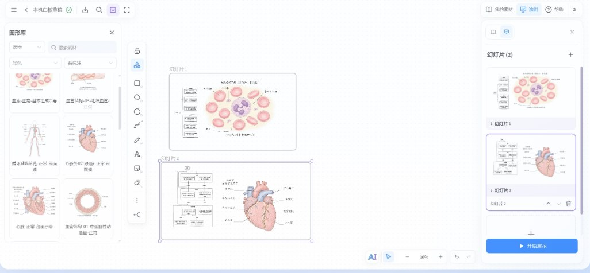

# 轻笔云图智绘白板怎么用，把图示、文字和演示放在一起

[返回信息图、智绘与白板](README.md) · [查看总目录](../../README.md)

白板适合把图示、标注、流程图和知识提纲放在同一空间，备课、课题讨论或项目汇报都可以按讲解顺序组织。

截图来自主站对应的工具介绍或公开示例。

## 操作步骤

1. 先确定白板里要解决的问题，划出概念、解释与结论等区域。按主题到图形库寻找能帮助说明的图示。
2. 在核心图旁添加短标题、箭头和文字要点。也可以先整理一张思维导图，再把它与示意图排在一起。
3. 将要分享的画布区域排成幻灯片，逐页预览。把后续还要修改的作品保存为可继续编辑的文件。

## 示例

课程备课可先讲图示结构，再放一个过程示意，最后用三点小结回顾本节内容。

## 完成后检查

文字在投影尺寸下能看清，箭头指向正确，分页后每页只有一个讲解重点。

[了解智绘白板](https://hajimicode.cn/tools/board?utm_source=github&utm_medium=referral&utm_campaign=academic_tools&utm_content=guide_whiteboard-guide_try) · [查看主站原教程](https://hajimicode.cn/tutorials/whiteboard-guide?utm_source=github&utm_medium=referral&utm_campaign=academic_tools&utm_content=guide_whiteboard-guide_source)
