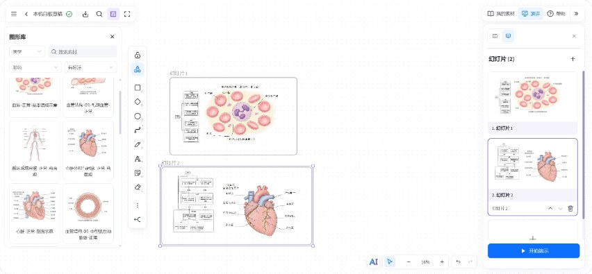

# 白板图形库怎么找医学图示和带标注素材

[返回信息图、智绘与白板](README.md) · [查看总目录](../../README.md)

选素材前先想清楚需要讲整体结构、局部名称还是过程。图示的标注密度与配色应匹配受众和使用场景。

截图来自主站原教程。

## 操作步骤

1. 打开图形库，先选主题分类，再试具体关键词，如心脏或血管。比较彩色、黑白、带标注或无标注版本。
2. 把选中的图示拖入白板，留出足够空间放说明。带标注版本适合讲解，无标注版本可以用来做辨认练习。
3. 用标题、对照箭头和简短标注引导读者从整体看到细节。适当缩减装饰，保证需要辨认的部位清晰。

## 示例

以心脏结构课为例，先展示完整图，再留一块区域给学生辨认心腔与主要血管。

## 完成后检查

核对图示标注和授课术语，缩放到课堂展示大小再看一遍。

[浏览智绘白板图形库](https://hajimicode.cn/tools/board?utm_source=github&utm_medium=referral&utm_campaign=academic_tools&utm_content=guide_whiteboard-shape-library_try) · [查看主站原教程](https://hajimicode.cn/tutorials/whiteboard-shape-library?utm_source=github&utm_medium=referral&utm_campaign=academic_tools&utm_content=guide_whiteboard-shape-library_source)
