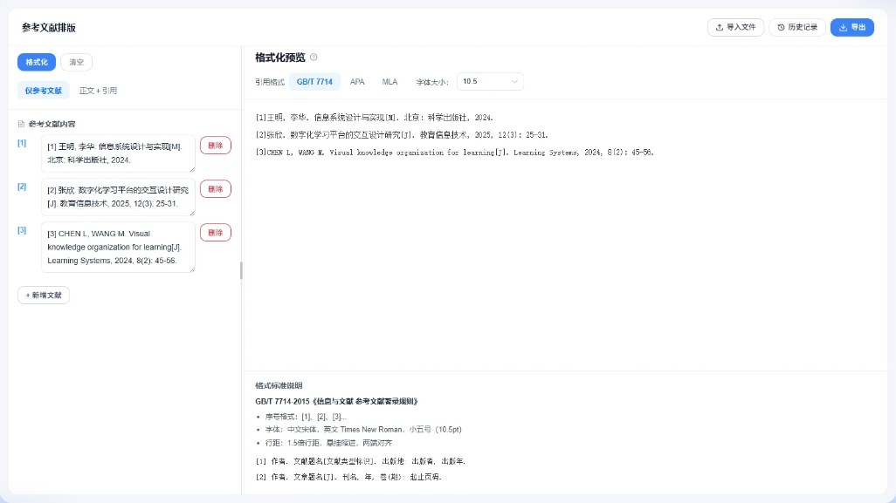
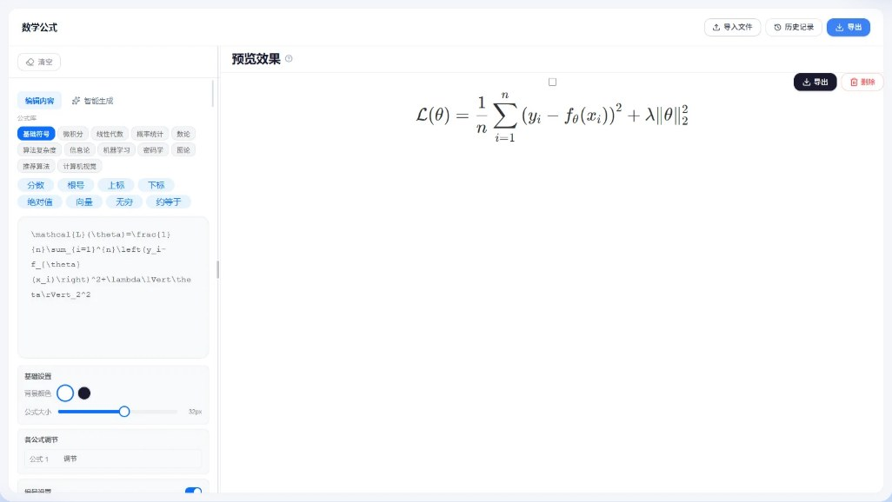
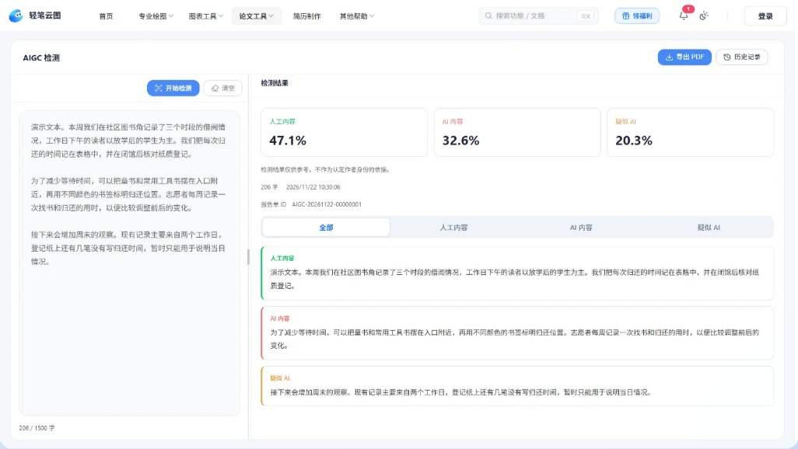
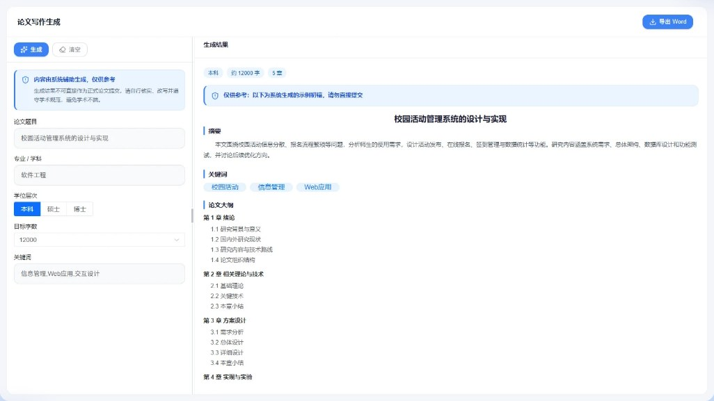

# 论文排版、写作与自查

[返回案例总览](../../README.md)

## 功能与截图

### Word 论文格式检查

按适用的学校模板检查 Word，结合报告与批注定位修改位置。

[查看主站介绍](https://hajimicode.cn/tools/format-check?utm_source=github&utm_medium=referral&utm_campaign=academic_tools&utm_content=module_format-check)

### 参考文献排版

将已核实的期刊、图书、网页著录信息排成参考文献。

[查看主站介绍](https://hajimicode.cn/tools/reference?utm_source=github&utm_medium=referral&utm_campaign=academic_tools&utm_content=module_reference)

### LaTeX 转 Word 公式

输入 LaTeX 公式后检查预览和 Word 导出效果。

[查看主站介绍](https://hajimicode.cn/tools/formula?utm_source=github&utm_medium=referral&utm_campaign=academic_tools&utm_content=module_formula)

### AIGC 文本检测

查看检测报告的分段结果，按原文和材料来源复核。

[查看主站介绍](https://hajimicode.cn/tools/aigc-check?utm_source=github&utm_medium=referral&utm_campaign=academic_tools&utm_content=module_aigc-check)

### 论文表达修改指南

查看论文语言修改与定稿准备指南，保留原意、引文和数据。

[查看主站介绍](https://hajimicode.cn/tools/paper-polish?utm_source=github&utm_medium=referral&utm_campaign=academic_tools&utm_content=module_paper-polish)

### 论文写作工具介绍

了解提纲与正文初稿的写作入口及当前页面说明。

[查看主站介绍](https://hajimicode.cn/tools/paper-writing?utm_source=github&utm_medium=referral&utm_campaign=academic_tools&utm_content=module_paper-writing)

## 教程

- [GB/T 7714 参考文献格式怎么整理期刊、书籍和网页](references.md)
- [Word 论文自动目录和页码怎么设置，正文如何从 1 开始](toc-page-numbers.md)
- [论文语句怎么修改，保留原意、数据和引用](paper-polish.md)
- [毕业论文 Word 格式怎么查，怎样看 PDF 报告和批注](format-check.md)
- [AIGC 文本检测报告怎么看，如何复核分段结果](aigc-check.md)
