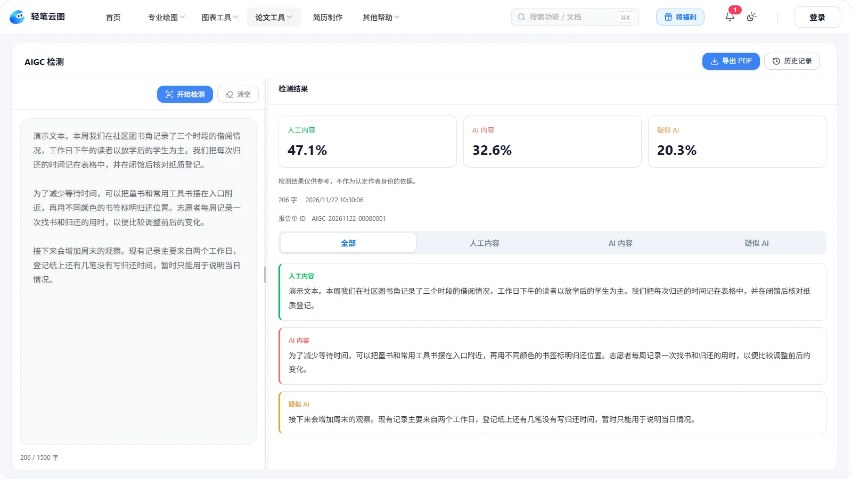

# AIGC 文本检测报告怎么看，如何复核分段结果

[返回论文排版、写作与自查](README.md) · [查看总目录](../../README.md)

文本检测报告能提示需要人工复核的片段。阅读时把报告和原文一起打开，结合资料引用与写作过程判断。

截图来自主站原教程。

## 操作步骤

1. 提交需检查的文本前，准备一份用于复核的稿件。例子可使用脱敏或自拟的短段落。
2. 对照检测报告中的分段标记，回到原文看术语、引文、定义和段落逻辑。记录需要进一步查证的位置。
3. 保存报告后，把需要说明的片段与来源一起整理。修订表达时核对事实、数据和引用。

## 示例

对于一段教材定义和自己的讨论紧挨在一起的稿件，先确认引文范围，再分别检查引用和讨论部分的表达。

## 完成后检查

判断依据能在原文和来源中找到，检测百分比作为自查线索使用。

[查看 AIGC 大模型文本检测](https://hajimicode.cn/tools/aigc-check?utm_source=github&utm_medium=referral&utm_campaign=academic_tools&utm_content=guide_aigc-check_try) · [查看主站原教程](https://hajimicode.cn/tutorials/aigc-check?utm_source=github&utm_medium=referral&utm_campaign=academic_tools&utm_content=guide_aigc-check_source)
