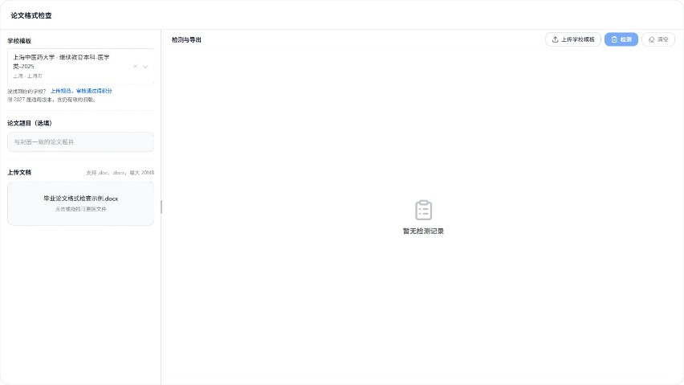

# 毕业论文 Word 格式怎么查，怎样看 PDF 报告和批注

[返回论文排版、写作与自查](README.md) · [查看总目录](../../README.md)

格式检查的第一步是选对学校模板。报告能帮助定位问题，修改时仍需要在适用的规范和论文原稿中核对。

截图来自主站原教程。

## 操作步骤

1. 搜索学校和模板，核对院系、学位、适用年份和可用的专业类别。选择适用模板后提交 Word 文件。
2. 阅读检查报告，优先处理影响全篇的样式问题。用 Word 批注查对应段落、标题、页眉页脚和题注。
3. 在原稿或带批注的副本中按规范修改，更新目录与引用，再将修订稿用于复查。

## 示例

如果正文行距和多处标题样式不一致，优先修正对应的 Word 样式，再核对少数有特殊要求的段落。

## 完成后检查

检查报告和批注指向一致，提交前确认纸张、页码、图表编号和参考文献未被误改。

[选择模板并检查 Word 论文](https://hajimicode.cn/tools/format-check?utm_source=github&utm_medium=referral&utm_campaign=academic_tools&utm_content=guide_format-check_try) · [查看主站原教程](https://hajimicode.cn/tutorials/format-check?utm_source=github&utm_medium=referral&utm_campaign=academic_tools&utm_content=guide_format-check_source)
