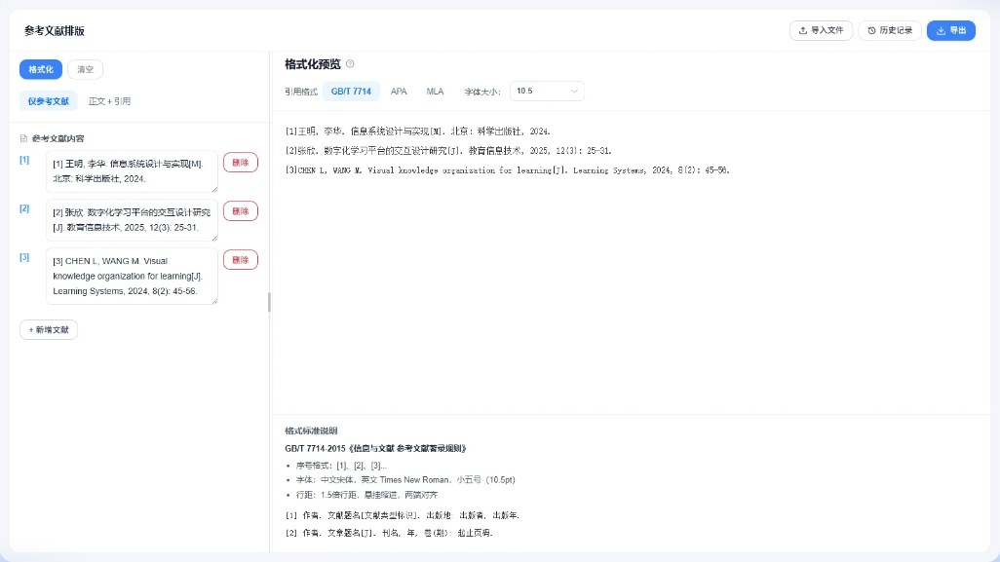

# GB/T 7714 参考文献格式怎么整理期刊、书籍和网页

[返回论文排版、写作与自查](README.md) · [查看总目录](../../README.md)

参考文献排版从核实原始信息开始。确定学校或期刊采用的版本、顺序编码制或著者–出版年制，再排格式。

截图来自主站对应的工具介绍或公开示例。

## 操作步骤

1. 期刊先找作者、文章题名、刊名、出版年卷期和页码。书籍查作者或编者、书名、版次、出版社和出版年。
2. 网页补齐页面标题、可核实的发布者、链接和适用要求的引用日期。文献类型标识与实际载体对应。
3. 排完后逐条核对正文引用、文末条目和原始来源，修正同一文献的重复记录。

## 示例

可用一篇期刊论文、一本专著与一份机构网页各做一条样例，观察著录字段的差异。

## 完成后检查

作者、年份与原文一致，同一份文档使用统一的引用顺序和标点。

[查看参考文献排版工具](https://hajimicode.cn/tools/reference?utm_source=github&utm_medium=referral&utm_campaign=academic_tools&utm_content=guide_references_try) · [查看主站原教程](https://hajimicode.cn/tutorials/references?utm_source=github&utm_medium=referral&utm_campaign=academic_tools&utm_content=guide_references_source)
