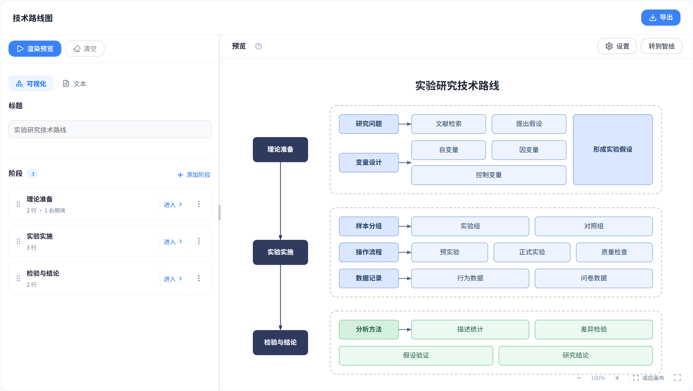
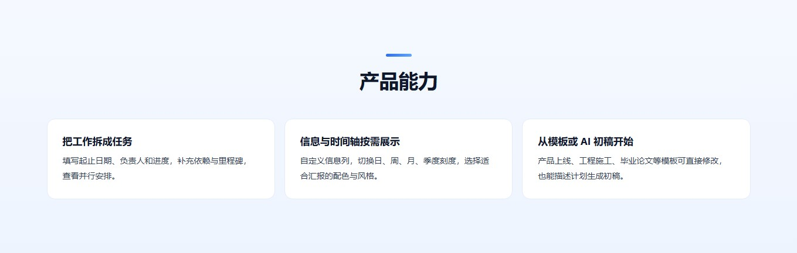
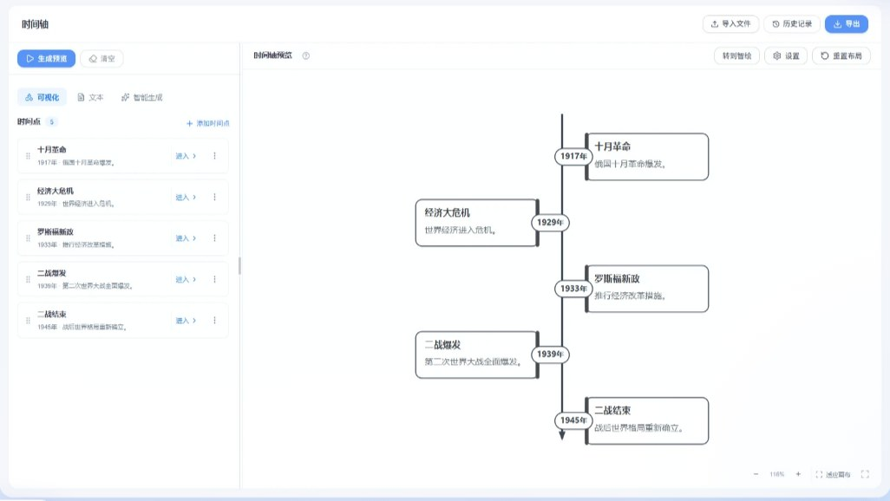
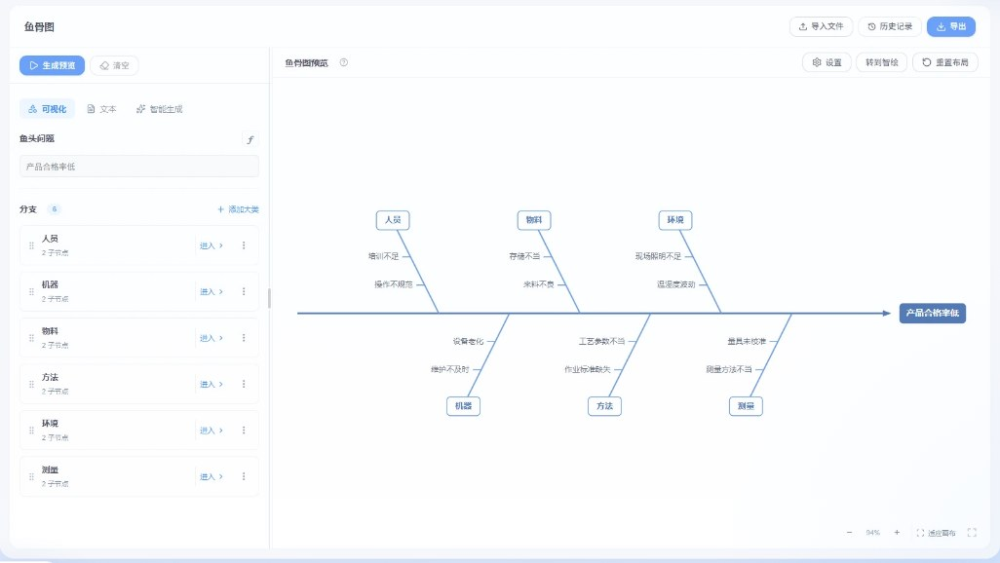
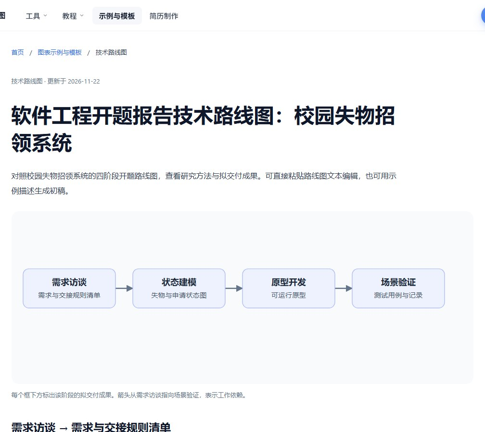
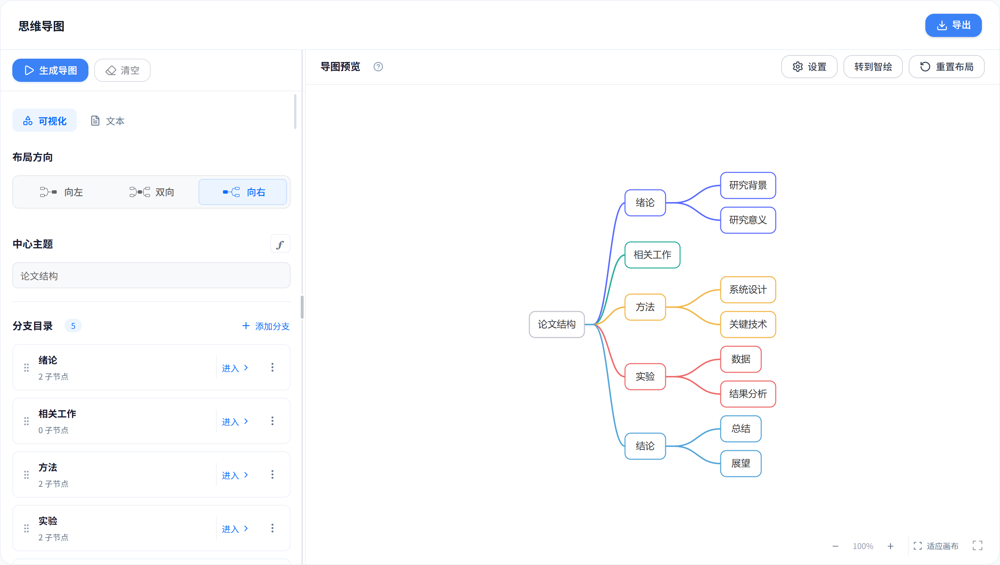

# 研究规划与项目汇报

[返回案例总览](../../README.md)

## 功能与截图

### 技术路线图

把研究问题、阶段、任务与验证方式连成一条可追踪的路径。

[查看主站介绍](https://hajimicode.cn/tools/roadmap?utm_source=github&utm_medium=referral&utm_campaign=academic_tools&utm_content=module_roadmap)

### 甘特图

为任务补起止日期、先后依赖和负责人，用里程碑记录交付。

[查看主站介绍](https://hajimicode.cn/tools/gantt?utm_source=github&utm_medium=referral&utm_campaign=academic_tools&utm_content=module_gantt)

### 时间轴

用发生顺序组织工作记录、活动安排或项目关键事件。

[查看主站介绍](https://hajimicode.cn/tools/timeline?utm_source=github&utm_medium=referral&utm_campaign=academic_tools&utm_content=module_timeline)

### 鱼骨图

从人员、设备、方法和环境等方向列出待验证的原因。

[查看主站介绍](https://hajimicode.cn/tools/fishbone?utm_source=github&utm_medium=referral&utm_campaign=academic_tools&utm_content=module_fishbone)

### 开题报告技术路线图案例

通过校园失物招领系统示例理解研究阶段与验证产出如何对应。

[查看主站介绍](https://hajimicode.cn/templates/proposal-research-roadmap?utm_source=github&utm_medium=referral&utm_campaign=academic_tools&utm_content=module_roadmap-example)

### 论文提纲思维导图案例

用主题、章节和子节点检查论文提纲的层级与覆盖范围。

[查看主站介绍](https://hajimicode.cn/templates/thesis-outline-mindmap?utm_source=github&utm_medium=referral&utm_campaign=academic_tools&utm_content=module_thesis-outline)

## 教程

- [开题报告技术路线图怎么画，阶段和产出怎么写](research-roadmap.md)
- [文字转思维导图，怎样整理论文提纲和课程知识](mindmap-outline.md)
- [甘特图怎么安排四周任务、依赖与交付里程碑](gantt-project-plan.md)
