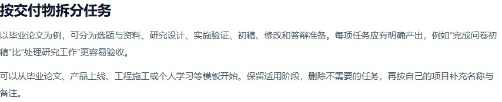

# 甘特图怎么安排四周任务、依赖与交付里程碑

[返回研究规划与项目汇报](README.md) · [查看总目录](../../README.md)

甘特图用横条表示任务持续时间，适合同时查看准备、执行、复核和交付。先从能被验收的工作成果拆任务。

截图来自主站原教程。

## 操作步骤

1. 列任务和计划日期。示例的第一周完成调研方案，第二周采集数据，第三周分析，第四周复核和汇报。
2. 标明哪些工作可以同时进行，哪些需要前一步交付。比如资料整理可与采集并行，分析应等所需数据到齐。
3. 把成果验收标成一个日期，同时核对负责人和工期。将时间轴切到适合汇报篇幅的刻度后再导出。

## 示例

把课程实验报告做成四周排期，分别记录实验准备、原始数据、图表成品和报告终稿。

## 完成后检查

里程碑写的是发生在一天的成果，任务横条对应实际持续时间。

[制作项目排期甘特图](https://hajimicode.cn/tools/gantt?utm_source=github&utm_medium=referral&utm_campaign=academic_tools&utm_content=guide_gantt-project-plan_try) · [查看主站原教程](https://hajimicode.cn/tutorials/gantt-project-plan?utm_source=github&utm_medium=referral&utm_campaign=academic_tools&utm_content=guide_gantt-project-plan_source)
