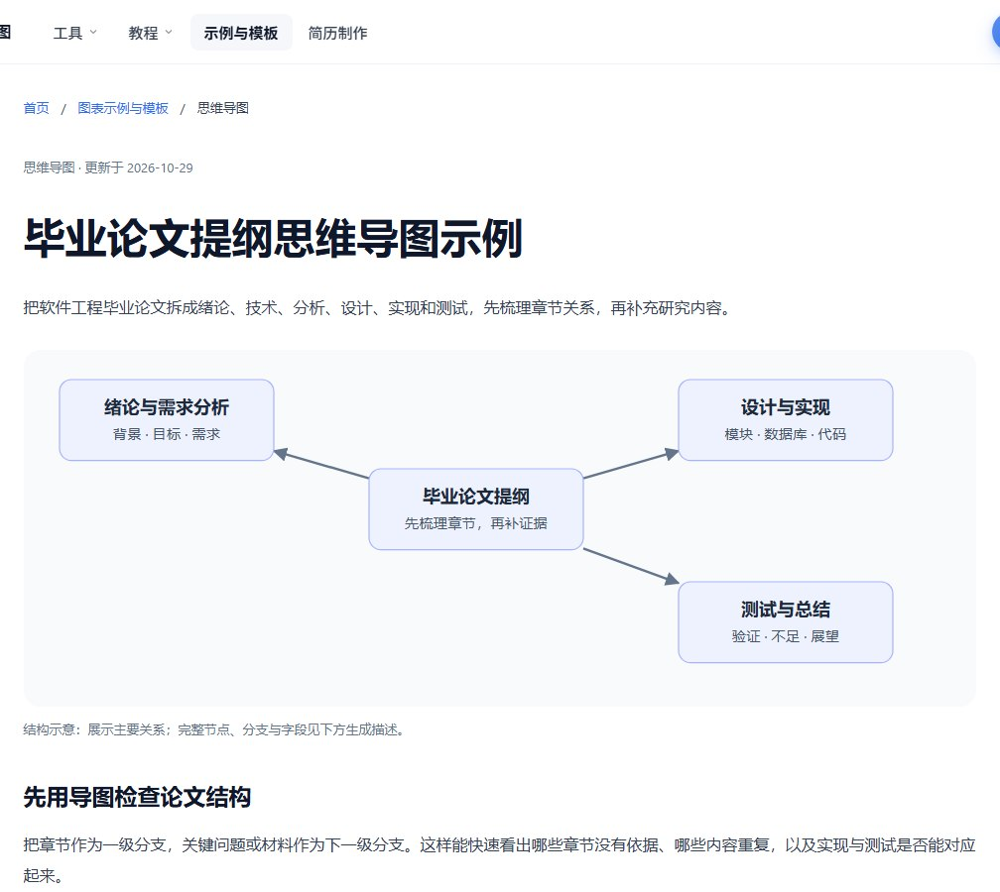

# 文字转思维导图，怎样整理论文提纲和课程知识

[返回研究规划与项目汇报](README.md) · [查看总目录](../../README.md)

把已有文字中的主题与上下位关系整理成树状结构，可以快速检查提纲是否漏项、重复或层级错位。

截图来自主站对应的工具介绍或公开示例。

## 操作步骤

1. 先找中心主题，再找同一级的几个分支。例如论文可按问题、方法、结果与讨论划出一级分支。
2. 给每个分支补小标题和证据线索，例如在结果下写主要观察、对照和异常。把长句压成短语。
3. 用文字导入或生成初稿后，逐项检查同一个分支下的节点是否属于同一层级。按阅读顺序调整位置。

## 示例

课程复习可以从「植物的水分运输」展开结构、机制、实验三个分支，再给每一支加关键概念和图例。

## 完成后检查

中心主题明确，同级分支粒度相近，每个末级节点都有实际内容。

[在线生成思维导图](https://hajimicode.cn/tools/mindmap?utm_source=github&utm_medium=referral&utm_campaign=academic_tools&utm_content=guide_mindmap-outline_try) · [查看主站原教程](https://hajimicode.cn/tutorials/mindmap-outline?utm_source=github&utm_medium=referral&utm_campaign=academic_tools&utm_content=guide_mindmap-outline_source)
