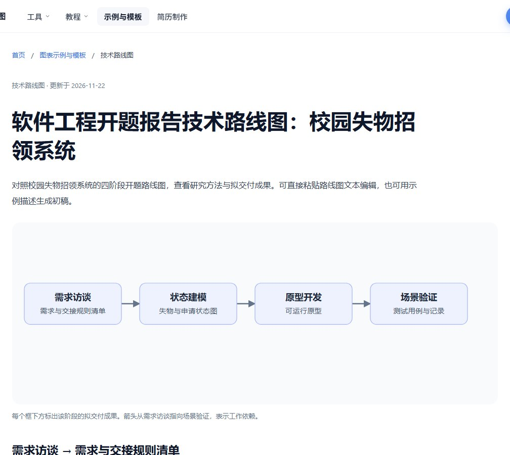

# 开题报告技术路线图怎么画，阶段和产出怎么写

[返回研究规划与项目汇报](README.md) · [查看总目录](../../README.md)

技术路线图把研究问题、方法与验证步骤连成一条逻辑线。每个阶段都应写出可检查的产物。

截图来自主站对应的工具介绍或公开示例。

## 操作步骤

1. 先写研究目标和验证标准。例如调查校园用水情况，并通过前后对照检验节水建议是否可行。
2. 按调研、方案、实施、验证四类工作拆分，给每类写一项具体产物，如记录表、分析方案、统计结果或核验说明。
3. 画出依赖和必要的返回步骤，对照开题报告的研究方法、实施条件与计划安排，确认同一阶段使用一致的名称。

## 示例

校园节水调研可从确认采样点开始，接着采集记录、比较场景并形成节水建议，最后用复测结果评价改进。

## 完成后检查

去掉图中解释不了的方框，每个阶段都能在正文找到对应内容。

[在线制作技术路线图](https://hajimicode.cn/tools/roadmap?utm_source=github&utm_medium=referral&utm_campaign=academic_tools&utm_content=guide_research-roadmap_try) · [查看主站原教程](https://hajimicode.cn/tutorials/research-roadmap?utm_source=github&utm_medium=referral&utm_campaign=academic_tools&utm_content=guide_research-roadmap_source)
