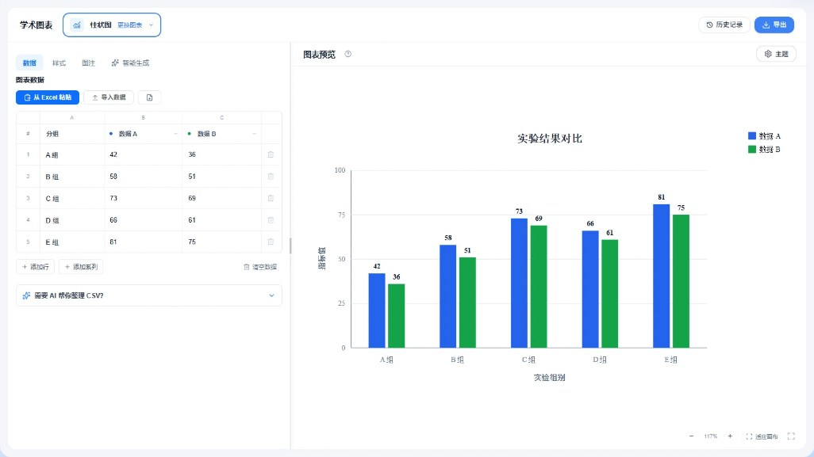
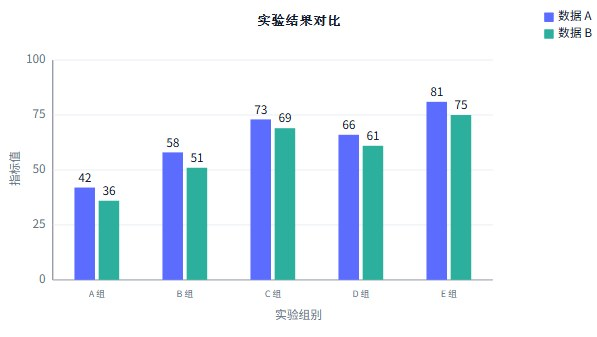
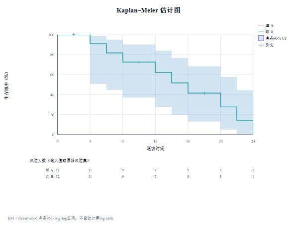
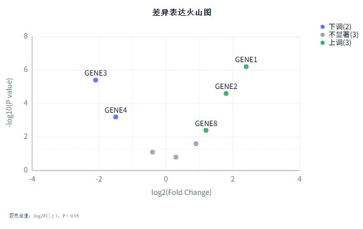
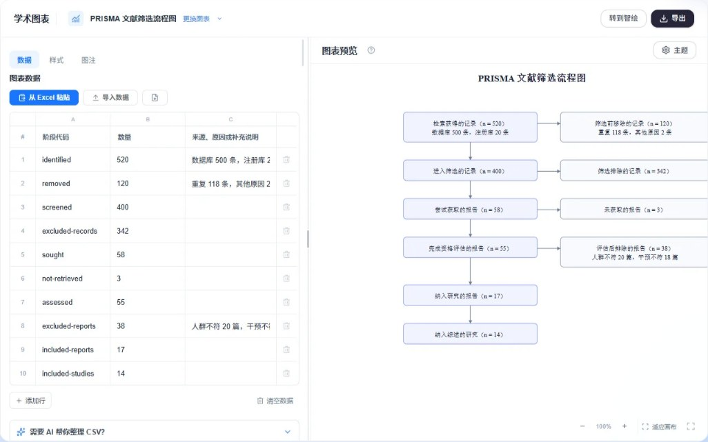

# Excel 数据与科研图表

[返回案例总览](../../README.md)

## 功能与截图

### 学术图表目录

按研究领域和问题类型查找统计图、医学图、工程图和环境数据图。

[查看主站介绍](https://hajimicode.cn/tools/academic-charts?utm_source=github&utm_medium=referral&utm_campaign=academic_tools&utm_content=module_academic-charts)

### Excel 分组柱状图

用横轴类别与颜色分组比较数值，核对单位、图例与零基线。

[查看主站介绍](https://hajimicode.cn/tools/academic-charts/bar?utm_source=github&utm_medium=referral&utm_campaign=academic_tools&utm_content=module_bar)

### Kaplan–Meier 生存曲线

整理随访时间、事件或删失状态和组别，再查看生存曲线。

[查看主站介绍](https://hajimicode.cn/tools/academic-charts/kaplan-meier-raw?utm_source=github&utm_medium=referral&utm_campaign=academic_tools&utm_content=module_kaplan-meier)

### 火山图

把变化幅度和统计显著性放在一张图里，先明确使用 P 值还是 FDR。

[查看主站介绍](https://hajimicode.cn/tools/academic-charts/volcano?utm_source=github&utm_medium=referral&utm_campaign=academic_tools&utm_content=module_volcano)

### PRISMA 文献筛选流程图

记录文献检索、去重、筛选与纳入阶段的数量和排除理由。

[查看主站介绍](https://hajimicode.cn/tools/academic-charts/prisma-flow?utm_source=github&utm_medium=referral&utm_campaign=academic_tools&utm_content=module_prisma)
