# 系统设计与 UML

[返回案例总览](../../README.md)

## 功能与截图

### 系统架构图

从展示层、服务层和数据层入手，说明组件之间的连接。

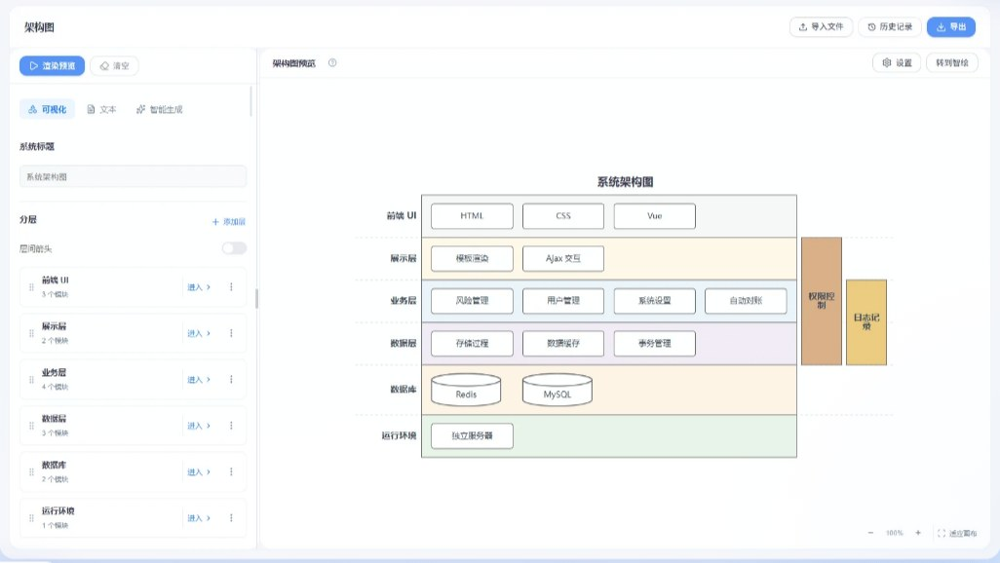

[查看主站介绍](https://hajimicode.cn/tools/architecture?utm_source=github&utm_medium=referral&utm_campaign=academic_tools&utm_content=module_architecture)

### 系统功能模块图

按产品场景与职责分解功能，区分一级模块和子功能。

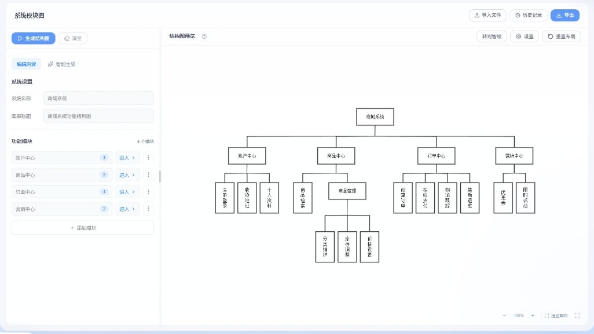

[查看主站介绍](https://hajimicode.cn/tools/diagram?utm_source=github&utm_medium=referral&utm_campaign=academic_tools&utm_content=module_system-modules)

### UML 类图与对象图

用类图表达类、属性、关联与继承，用对象图展示一个具体实例。

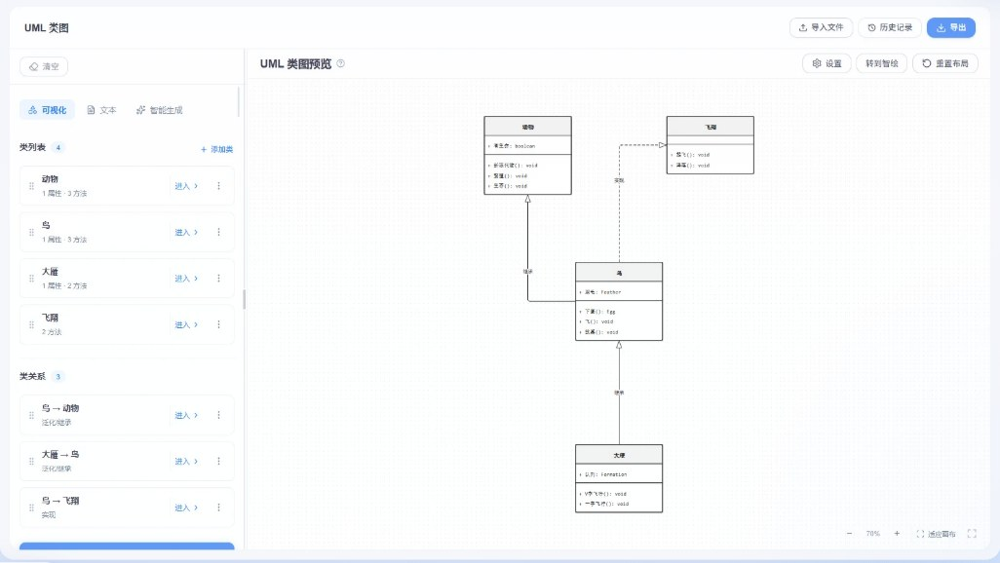

[查看主站介绍](https://hajimicode.cn/tools/uml-designer?utm_source=github&utm_medium=referral&utm_campaign=academic_tools&utm_content=module_uml)

### UML 用例图

从外部角色出发说明系统提供的目标和能力。

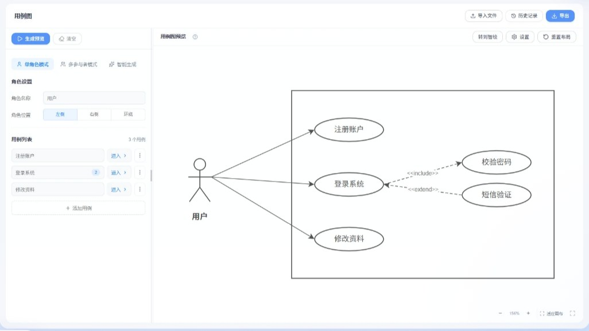

[查看主站介绍](https://hajimicode.cn/tools/usecase?utm_source=github&utm_medium=referral&utm_campaign=academic_tools&utm_content=module_usecase)

### 时序图

沿时间顺序排列请求、处理、返回与条件分支。

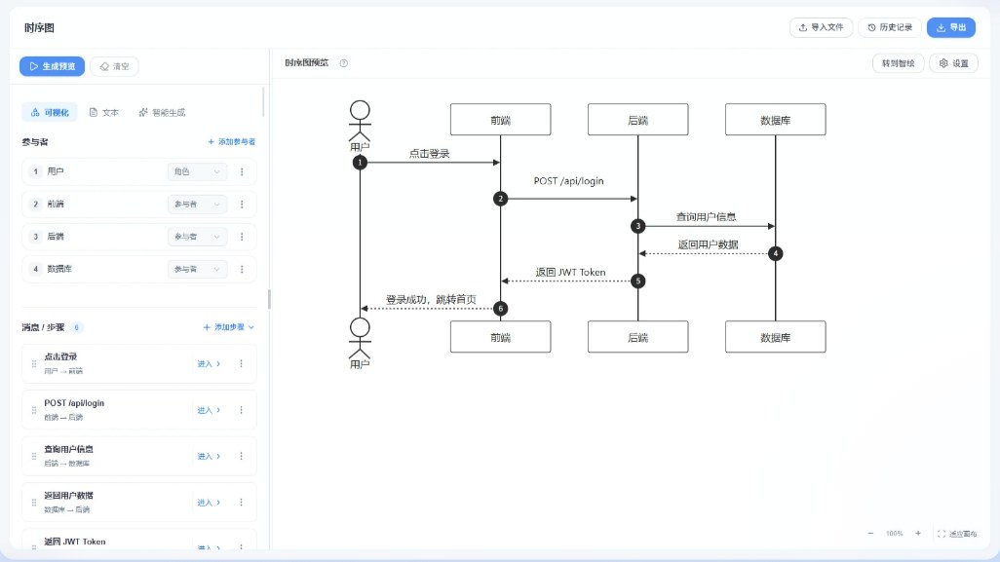

[查看主站介绍](https://hajimicode.cn/tools/sequence?utm_source=github&utm_medium=referral&utm_campaign=academic_tools&utm_content=module_sequence)

### UML 协作图

把参与对象与它们交换的消息放在同一个结构图中。

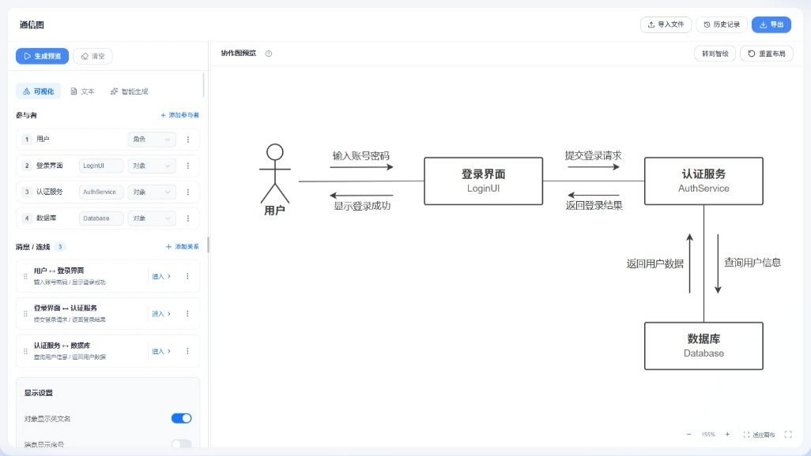

[查看主站介绍](https://hajimicode.cn/tools/communication?utm_source=github&utm_medium=referral&utm_campaign=academic_tools&utm_content=module_communication)

### 状态图

对照触发事件核对状态迁移，例如提交、审批、撤回和关闭。

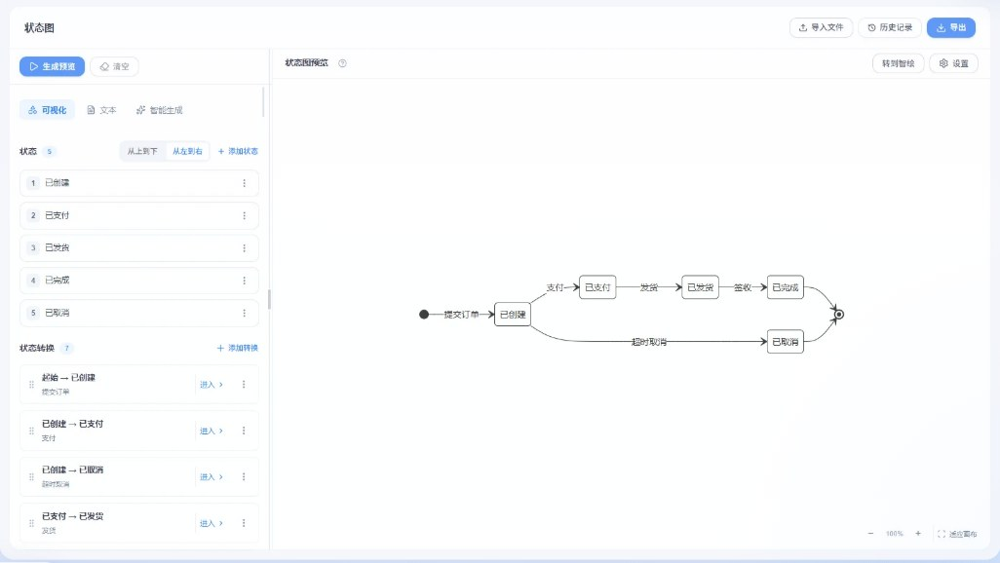

[查看主站介绍](https://hajimicode.cn/tools/state-diagram?utm_source=github&utm_medium=referral&utm_campaign=academic_tools&utm_content=module_state)

### 数据流图

追踪数据来源、处理、存储和输出，核对层级之间的流向。

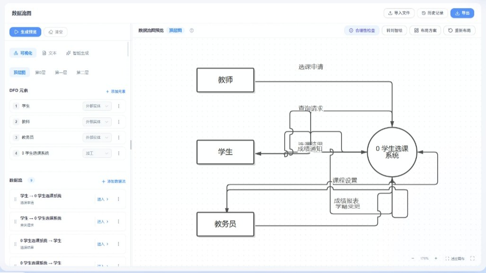

[查看主站介绍](https://hajimicode.cn/tools/dataflow?utm_source=github&utm_medium=referral&utm_campaign=academic_tools&utm_content=module_dataflow)

### 网络拓扑图

用设备和链路说明客户端、网关、交换机和服务器的连接。

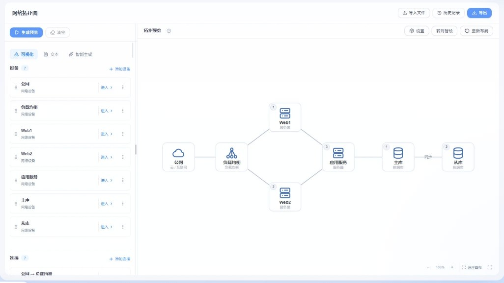

[查看主站介绍](https://hajimicode.cn/tools/topology?utm_source=github&utm_medium=referral&utm_campaign=academic_tools&utm_content=module_network)

### UML 部署图

标出制品分布在哪些运行节点，以及节点如何通信。

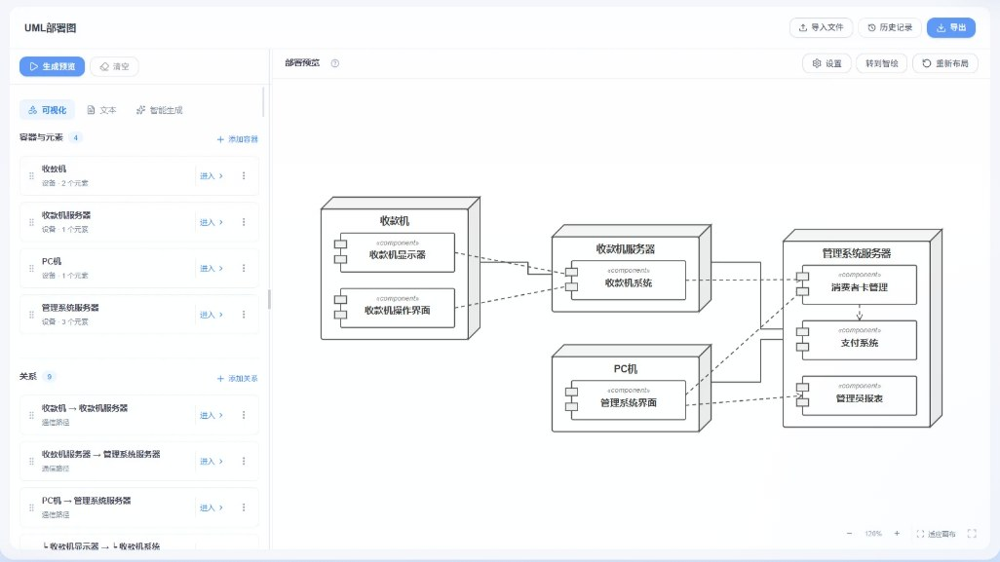

[查看主站介绍](https://hajimicode.cn/tools/deployment?utm_source=github&utm_medium=referral&utm_campaign=academic_tools&utm_content=module_deployment)

### 电商系统功能模块图案例

按买家端与管理端做模块拆分，理解功能树的层级。

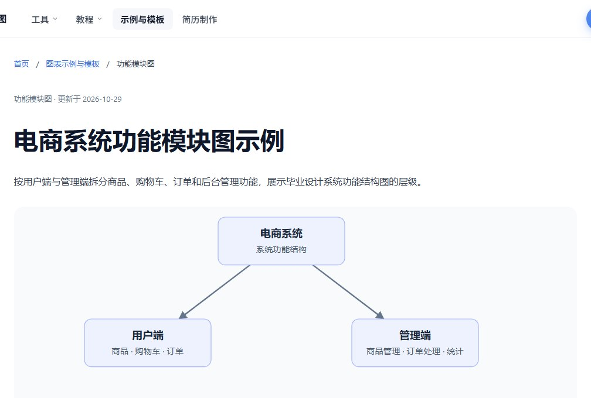

[查看主站介绍](https://hajimicode.cn/templates/ecommerce-function-modules?utm_source=github&utm_medium=referral&utm_campaign=academic_tools&utm_content=module_ecommerce-module-example)

### 三层系统架构图案例

对照三层实例检查界面、应用服务与数据之间的交互方向。

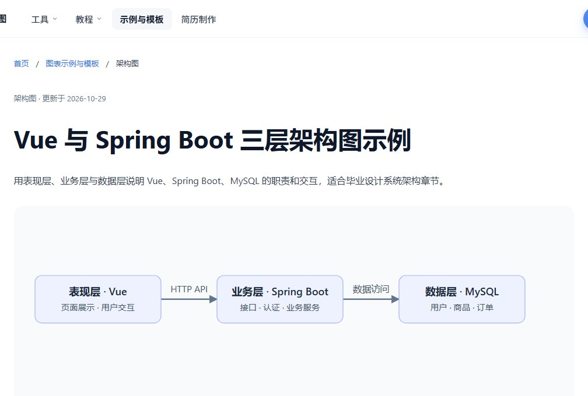

[查看主站介绍](https://hajimicode.cn/templates/three-tier-system-architecture?utm_source=github&utm_medium=referral&utm_campaign=academic_tools&utm_content=module_three-tier-example)

## 教程

- [UML 用例图怎么画，明确角色与系统边界](usecase-diagram.md)
- [时序图怎么画，消息和 alt 分支怎么表示](sequence-diagram.md)
- [数据流图怎么画，检查顶层和 0 层的输入输出](dataflow-diagram.md)
