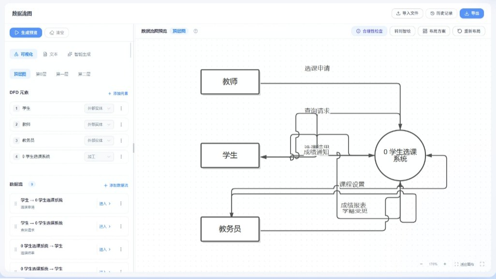

# 数据流图怎么画，检查顶层和 0 层的输入输出

[返回系统设计与 UML](README.md) · [查看总目录](../../README.md)

数据流图适合追踪数据从哪里来、经何处加工、去哪里存放。先定义系统范围和外部交换，再展开处理过程。

截图来自主站对应的工具介绍或公开示例。

## 操作步骤

1. 顶层图把整个系统当成一个处理，标出外部实体和输入输出。数据流用数据的名称标注，例如预约申请或审批结果。
2. 在 0 层图中拆成接收申请、审核、通知等处理过程，按需补数据存储和内部流向。
3. 检查子图与父图的外部输入输出是否相互对应。把跨层交换遗漏、没有输入的处理或无处理的数据转移改清楚。

## 示例

读者提交借阅申请，系统查询库存，保存借阅记录，再把办理结果发回读者。

## 完成后检查

外部流在不同层级保持平衡，每条箭头都有可理解的数据名称。

[在线制作数据流图](https://hajimicode.cn/tools/dataflow?utm_source=github&utm_medium=referral&utm_campaign=academic_tools&utm_content=guide_dataflow-diagram_try) · [查看主站原教程](https://hajimicode.cn/tutorials/dataflow-diagram?utm_source=github&utm_medium=referral&utm_campaign=academic_tools&utm_content=guide_dataflow-diagram_source)
