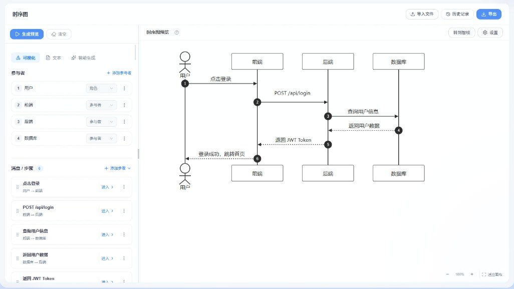

# 时序图怎么画，消息和 alt 分支怎么表示

[返回系统设计与 UML](README.md) · [查看总目录](../../README.md)

时序图沿时间轴展示参与者之间的消息。先选一个清晰的交互场景，再按实际发生顺序写消息。

截图来自主站对应的工具介绍或公开示例。

## 操作步骤

1. 横向列出使用者、界面、服务和数据存储等参与者，给每个参与者画生命线。
2. 按从上到下的顺序添加请求和返回，有必要时画激活区间，说明参与者在何时处理消息。
3. 有互斥结果时使用 alt 分支，重复请求才用 loop。若参与者较多，可以将异常场景单独画一张图。

## 示例

读者发起图书续借，服务先查询借阅状态，再根据是否允许续借返回新到期日或失败原因。

## 完成后检查

返回消息能对应原请求，分支条件相互明确，交互方向可读。

[在线制作 UML 时序图](https://hajimicode.cn/tools/sequence?utm_source=github&utm_medium=referral&utm_campaign=academic_tools&utm_content=guide_sequence-diagram_try) · [查看主站原教程](https://hajimicode.cn/tutorials/sequence-diagram?utm_source=github&utm_medium=referral&utm_campaign=academic_tools&utm_content=guide_sequence-diagram_source)
