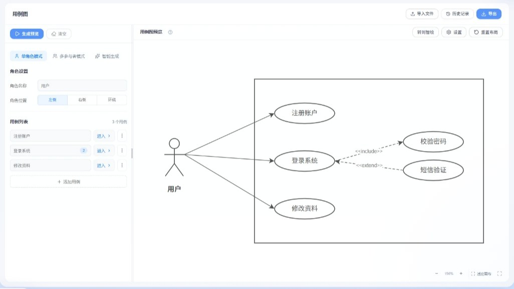

# UML 用例图怎么画，明确角色与系统边界

[返回系统设计与 UML](README.md) · [查看总目录](../../README.md)

用例图适合说明外部参与者希望达成哪些目标。先确定系统边界，再给目标命名。

截图来自主站对应的工具介绍或公开示例。

## 操作步骤

1. 列出使用者或外部系统，例如借阅者和管理员。用「查询可借设备」「登记归还」这样的动宾短语命名系统用例。
2. 把参与者放在边界外，把用例放在边界内。只有在需要说明共享的必经行为或特定条件下的扩展时，再添加相应的 UML 关系。
3. 把主要用例放在容易阅读的位置，视情况补上用例说明表，记录触发条件、主流程与例外。

## 示例

借阅系统中，学生可以浏览设备和申请借用，管理员审核申请并登记归还。

## 完成后检查

用例名称能讲清使用者要完成什么，关系方向遵循 UML 约定。

[在线画 UML 用例图](https://hajimicode.cn/tools/usecase?utm_source=github&utm_medium=referral&utm_campaign=academic_tools&utm_content=guide_usecase-diagram_try) · [查看主站原教程](https://hajimicode.cn/tutorials/usecase-diagram?utm_source=github&utm_medium=referral&utm_campaign=academic_tools&utm_content=guide_usecase-diagram_source)
